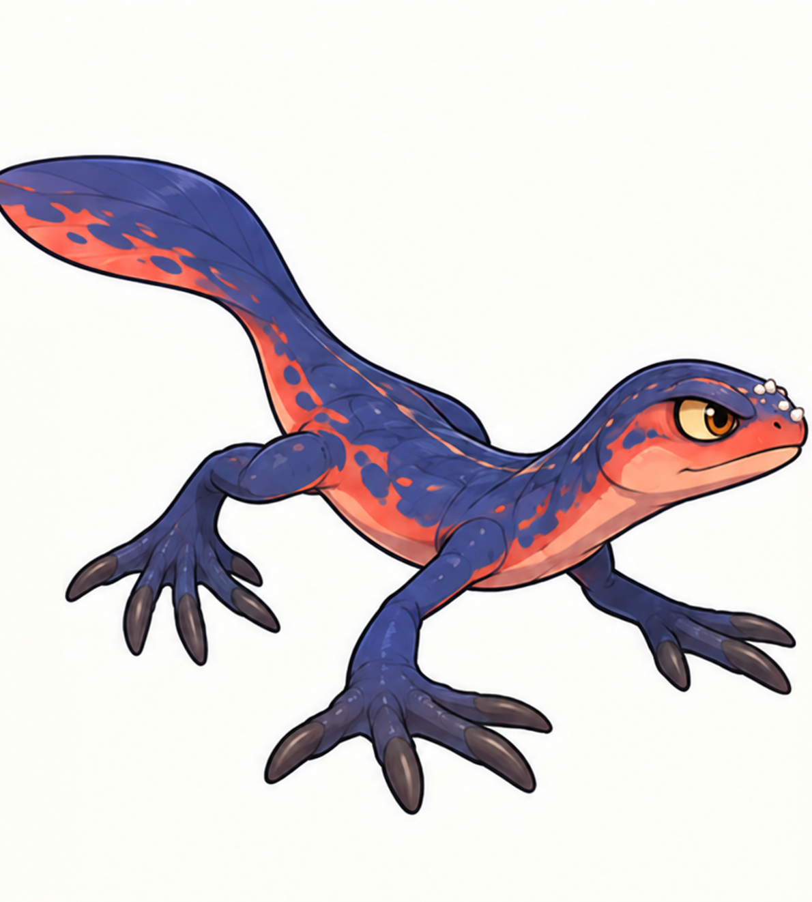

# Aguana

> Final name and base visual identity approved September 21, 2026. Production game assets and integration completed September 22, 2026; journal artwork remains open.

## Concept Summary

- **Name:** Aguana
- **Repository ID:** `aguana`
- **Name concept:** _Agua_ + _iguana_, directly expressing a young iguana adapted to life at the water's edge.
- **Typing:** Water
- **Evolution stage:** First stage; evolves into Nautiguan.
- **Biological basis:** Galápagos marine iguana (_Amblyrhynchus cristatus_), especially the intertidal foraging behavior of smaller individuals.
- **External inspiration:** Rocky tidal shores and the danger of feeding where every surge can pull a small grazer away. The design intentionally does not add a separate thematic costume or profession.
- **Character core:** A nimble intertidal grazer whose species identity centers on brief underwater feeding trips and an extraordinary ability to hold fast against the surf; individual temperament remains open rather than being prescribed by the species concept.
- **Core concept:** A young Water-type marine iguana Cosmoid that makes short dives for algae and anchors itself to slippery rocks with oversized hooked claws.
- **Signature silhouette:** A long, low body stretched between four widely planted clawed feet, ending in an enormous flattened paddle tail.

## Cosmoid Entry

It makes brief dives to graze on algae growing beneath the waves. Its hooked claws grip slippery rocks, keeping it from being swept away before it must return to shore and warm itself.

## Inspiration and Fictional Translation

### Verified natural anchors

- The [Galápagos Conservancy's biodiversity profile](https://www.galapagos.org/about_galapagos/biodiversity/) describes marine iguanas as seaweed grazers that feed on exposed and submerged rocks, use flattened tails for swimming, expel excess salt through glands connected to their nostrils, and return to land because they cannot remain in cold seawater indefinitely.
- A [field study indexed by PubMed](https://pubmed.ncbi.nlm.nih.gov/28313754/) reports a size-related division in foraging: smaller marine iguanas feed intertidally while larger individuals forage subtidally. This observation provides the biological spine for Aguana's evolution into Nautiguan.
- A physiological study of the species notes the demands of swimming through heavy surf and [gripping rocks to remain in place while feeding](https://www.sciencedirect.com/science/article/abs/pii/S1096495908000262).
- Research published in _Nature_ documents that adult marine iguanas can [reversibly shrink during harsh El Niño conditions](https://www.nature.com/articles/47396), inspiring the family's provisional growing-and-shrinking gameplay direction.

### Creative bridge

Marine-iguana shore feeding + the vulnerability of a small body in strong surf + a clear juvenile-to-adult ecological progression -> a streamlined first stage built around quick dives, anchoring claws, and a tail already oversized for swimming.

### Fictional elements

Aguana's coral-and-indigo coloration, exaggerated paddle tail, oversized gripping claws, concentrated nose crystals, Water typing, evolution, and any battle application of its biology are fictional Cosmoid traits. The real-world research is an inspiration source, not a complete description of the creature.

## Signature Behavior and Vignette

Aguana slips beneath a breaking wave, hooks all four feet into a slick rock, and grazes rapidly while its paddle tail streams behind it. As soon as the surge weakens, it releases its grip and skitters back onto the warm shore.

This behavior defines the species concept without fixing Aguana to one individual personality or nature.

## Visual Direction and Identity Lock

The approved base image above is the visual identity authority for future Aguana artwork.

- **Silhouette:** Long, low, and laterally stretched, with a slim body, a slightly raised neck, four widely spread limbs, and a huge leaf-shaped paddle tail sweeping upward behind it.
- **Body plan and proportions:** Four-legged marine-reptile body. The torso remains narrow and agile rather than becoming a miniature version of Nautiguan's heavy adult build. The tail is the largest single shape.
- **Head and face:** Small smooth wedge-shaped head with a long low snout, a firm closed mouth, one prominently visible golden-orange eye, and a heavy indigo upper eye shape that creates an alert expression.
- **Feet and claws:** Four broad, splayed multi-digit feet with conspicuously long dark hooked claws. Preserve their gripping read; do not simplify them into ordinary lizard toes or swimming flippers.
- **Signature feature:** A few small pale salt nubs confined to the nostrils and front brow. They must remain modest and must not continue down the head, neck, or back at this stage.
- **Back:** Smooth and low, with no dorsal salt ridge, crystal crown, or developed spines.
- **Palette:** Deep indigo-blue across the back, limbs, and outer tail; saturated coral-red across the face, flanks, tail underside, and belly; warm peach throat and underside; golden-orange eye; charcoal-brown claw tips; restrained off-white salt nubs.
- **Markings:** Organic coral patches break irregularly into the indigo sides and limbs. Preserve their flowing, asymmetric distribution rather than replacing them with stripes or regular spots.
- **Materials:** Smooth stylized reptile skin, hard dark claws, and only a tiny amount of chalky salt at the nose.
- **Shape language:** One long flowing body line, broad hand-like feet, and a single oversized curved tail blade. The visual rhythm should communicate skittering, gripping, and swimming.
- **Rendering:** Original polished 2D creature-collection RPG art with clean dark outlines, controlled painted/cel shading, and an uncluttered pale background.
- **Prohibited drift:** Do not add dorsal crystals, a salt mane, armor, clothing, nautical equipment, realistic skin microtexture, or a squat adult body shape.

## Evolutionary Premise

Aguana represents the smaller intertidal phase of the family. Its proportions favor quick movement, shallow feeding, and secure rock-gripping. Evolution into Nautiguan changes the family's ecological role rather than merely scaling the same design upward: the body becomes broad and heat-retaining, the claws and tail become visibly powerful, dives become longer and deeper, and the tiny nasal salt deposits develop into a dramatic crystalline crown and dorsal fringe.

The family may also express reversible growth and shrinkage during changing food conditions. That direction is approved at the conceptual level, but no evolution condition or mechanical implementation has been chosen.

## General Gameplay Direction

These are approved sources of possible abilities and attacks, not defined mechanics:

- Growth and shrinkage in response to food scarcity or environmental pressure
- Hooked claws that anchor the creature against movement or currents
- A paddle tail used for propulsion and forceful strikes
- Salt expulsion, which becomes much more prominent after evolution
- Short dives and quick shoreline movement as Aguana's stage-specific emphasis

## Creation Record

- **Creation date:** September 21, 2026
- **Final name selected:** September 21, 2026
- **Concept development:** Developed as the first stage of a pure Water marine-iguana family. Juvenile concept 8 was selected, then revised so the salt deposits remain small and concentrated around the nose rather than extending along the back.
- **Approved concept image:** [`docs/cosmoids/images/aguana-concept.png`](./images/aguana-concept.png)
- **Image status:** Preserved unchanged from the user-approved revised standalone render.
- **Family:** Aguana -> Nautiguan
- **Production date:** September 22, 2026
- **Production assets:** Tight portrait icon plus left, up, and down directional battle sprites, with PNG masters under `art-source/creatures` and transparency-preserving WebP derivatives in `apps/web/public`.
- **Gameplay implementation:** Pure Water type with a fast juvenile stat profile, `SCRATCH`, `WATER_GUN`, and `DEEPWATER_GRIP`; evolves into Nautiguan at level 16.
- **Story placement:** Capturable level-8 Aguana appear in both Level 6 waves on the center lane.
- **Manifest:** [`apps/web/src/content/creatures/aguana.json`](../../apps/web/src/content/creatures/aguana.json)
- **Production status:** Integrated into the creature registry, tower-defense visuals, Level 6 encounter data, and creature manifest. Journal scene and journal artwork remain open.

## Open Decisions

- How growing and shrinking would manifest mechanically, if used
- Broader habitat distribution and rarity beyond the Level 6 encounter
- Journal scene and journal artwork

Individual natures or personality variants are intentionally outside this species-concept record.
