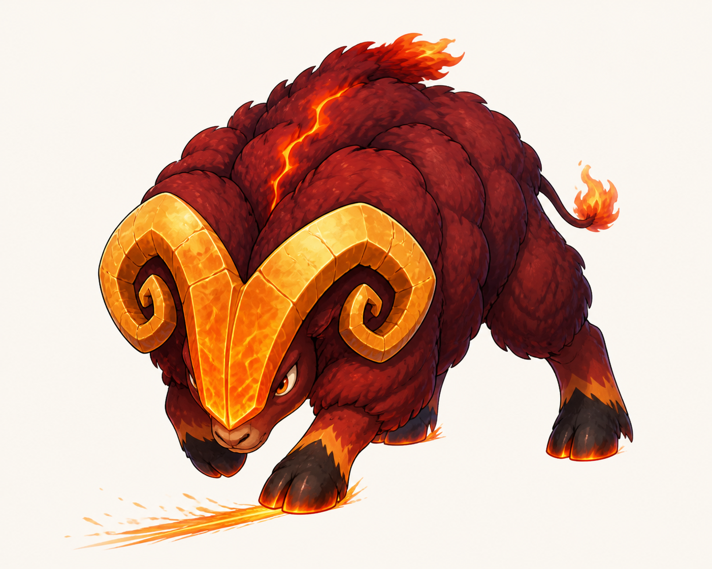

# Bramfrit

> Concept record created August 30, 2026. Bramfrit's game assets, creature registry entry, and creation record are implemented; its Level 5 captive-ally behavior remains planned.

## Concept Summary

- **Name:** Bramfrit
- **Name concept:** Battering ram + ifrit, expressing a siege creature animated by a fiery spirit
- **Typing:** Fire
- **Creature basis:** Desert bighorn ram
- **External inspiration:** Battering rams, formal duels, and ceremonial countdowns
- **Story placement:** Captive Cosmoid in Level 5's Ironbell Navy prison
- **Core concept:** A proud, courtly challenger with enough force to break a fortified gate, but a strict sense of fairness prevents it from charging until it has formally warned its opponent.
- **Signature silhouette:** A compact wedge-shaped ram whose two squared spiral horns sweep forward and align into one broad, blunt battering face.

## Character and Story Hook

Bramfrit should inspire admiration with a small amount of comedy. It is tremendously powerful, but its strength is governed by ritual rather than anger. Before charging any opponent or obstacle, it bows, backs up exactly three paces, scratches a glowing starting line, lowers its horns, and waits for the challenge to be acknowledged.

The behavior is species-level rather than a personal trick. Bramfrit instinctively treats walls, gates, and other immovable obstacles as stubborn opponents that deserve a fair warning.

This particular Bramfrit was imprisoned after repeatedly challenging the Navy's supposedly unbreakable gates. The Navy regarded it as a destructive nuisance; Bramfrit believed it was participating in an honorable contest.

## Inspiration

Desert bighorn rams naturally compete by facing one another, charging head-on, and striking with their large curved horns. Their thick skulls and powerful, compact builds support Bramfrit's impact-focused anatomy.

- [National Park Service: Desert Bighorn Sheep in Grand Canyon](https://www.nps.gov/articles/desert-bighorn-sheep.htm)
- [National Park Service: Sheep and Goat Superpowers](https://www.nps.gov/places/sheep-and-goat-superpowers-exhibit.htm)
- [National Park Service: bighorn sheep ramming-heads recording](https://www.nps.gov/subjects/sound/sounds-bighorn-ram.htm)

The battering-ram mechanism, formal duel, three-step countdown, and heated horn surface are fictional design extrapolations. They create a functional bridge between the animal basis, Fire typing, personality, and Level 5 objective rather than acting as decorative motifs.

## Signature Vignette

Bramfrit bows toward a barred gate, retreats exactly three paces, scratches a short glowing line into the floor with one forehoof, and waits in a lowered charge stance. Its expression is determined but patient: the force is ready, but the ritual is not yet complete.

This moment should guide future concept art, animations, dialogue reactions, and gameplay telegraphing. Bramfrit should not read as a permanently furious or uncontrolled attacker.

## Visual Direction

- Compact, muscular ram anatomy with a wedge-shaped line of action.
- Short, powerful pillar legs rather than tall or goatlike proportions.
- Deep wine-maroon and burgundy fleece organized into broad, readable masses.
- Charcoal lower legs and hooves with restrained ember heat at their edges.
- Two enormous golden-orange squared spiral horns.
- Horns visibly converge into one broad, blunt striking face when the head is lowered.
- Horns remain organic growths rather than metal armor, a helmet, a weapon, or machinery.
- Determined amber eyes and a small, visible muzzle preserve the character's expression beneath the horns.
- Fire effects remain restrained: internal horn seams, warm hoof edges, and the glowing starting-line scratch.
- Approximately pony-sized.

The concept image is a design reference, not a production sprite. Future assets should follow the project's smooth painted 2D battle-art direction while simplifying the fleece and horn planes enough for the silhouette, face, and battering surface to remain legible at approximately 64-128 pixels.

## Level 5 Gameplay Intent

Bramfrit occupies one of the optional cells connected to the Level 5 paths. Opening its cell releases it as an allied prisoner that travels toward Tigrevel's main gate and contributes directly to the breach.

Its gate behavior should preserve the three-step ritual:

1. Bow or acknowledge the gate.
2. Retreat three short steps and scratch a glowing starting line.
3. Pause briefly in a clearly telegraphed charge stance.
4. Charge the gate and deal a large burst of Fire structure damage.

The impact should visibly dent or crack the gate, creating a weak point that improves the readability of every prisoner's combined effort. Bramfrit should be especially valuable against the Steel-type structure without becoming the only viable way to finish the level.

Because the ritual includes a deliberate pause, the player can anticipate each major hit and understand Bramfrit's personality through gameplay rather than exposition alone.

## Design Tests to Preserve

- **Ten-word read:** An honorable fire ram that formally challenges walls before charging.
- **Five-second read:** Bow, three paces, glowing line, lowered battering horns.
- **Silhouette read:** Compact wedge body dominated by paired horns forming one striking face.
- **Character contradiction:** Immense destructive strength governed by extreme courtesy and patience.
- **One surprise:** It treats a locked gate as an opponent deserving a fair duel.

## Creation Record

- **Concept selected:** Fire-prisoner exploration, option 3
- **Selection date:** August 30, 2026
- **Concept-art file:** `docs/cosmoids/images/bramfrit-concept.png`
- **Game icon:** `apps/web/public/UI/Icons/bramfrit_icon.png`
- **Directional battle art:** `apps/web/public/battles/cosmoids/bramfrit_left.webp`, `bramfrit_up.png`, and `bramfrit_down.png`
- **Creation provenance:** [historical integration record](../art/CREATURE_PROVENANCE.md)
- **Image status:** Approved concept direction and production game assets implemented
- **Initial gameplay profile:** Fire type; bulky physical attacker; starts with Tackle and learns Ember at level 4

## Open Decisions

- Decide whether it is a single-stage Cosmoid or the first stage of a lineage about balancing ritual with urgent protection.
- Define its cell location and the order in which players are likely to release it.
- Determine charge cadence, structure damage, wind-up duration, and whether its impacts temporarily expose a vulnerable gate section.
- Decide how it behaves when enemies interrupt its ritual or stand between it and the gate.
- Create journal artwork after its habitat and observed wild behavior are finalized.
- Implement optional-cell release, allied navigation, and the three-step gate-charge sequence.
