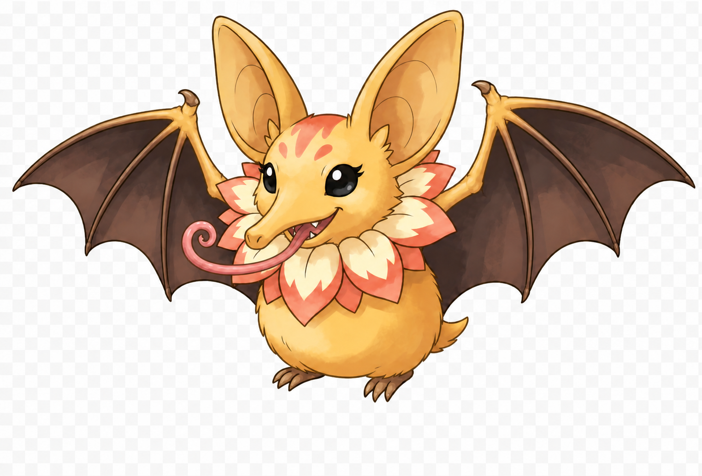

# Bufflora

> Concept record created August 31, 2026. Bufflora is an approved Poison/Grass wild creature with production assets, registry data, and a capturable Level 5 introduction.

## Concept Summary

- **Name:** Bufflora
- **Name concept:** *Buff* and *fluffy* + *flora*, reflecting its warm golden coat, flowerlike ruff, and real-world buffy flower bat inspiration
- **Typing:** Poison/Grass
- **Creature basis:** Buffy flower bat and other nectar-feeding New World leaf-nosed bats
- **External inspiration:** Tropical blossoms, cave-to-surface pollination, and poisonous flowering plants
- **In-world nickname:** Cave flower
- **Story placement:** A wild Cosmoid associated with Level 5's wet underground cave environment rather than one of its prisoners
- **Core concept:** A cheerful cave-roosting flower bat that emerges after dark to drink from surface blossoms and especially favors poisonous species avoided by other pollinators.
- **Signature silhouette:** A compact golden pear-shaped bat framed by enormous upright ears, broad open wings, and a layered cream-and-coral blossom ruff.

## Character and Ecological Hook

Bufflora should feel immediately sweet, curious, and approachable despite its Poison typing. Its central contradiction is that this gentle pollinator eagerly seeks out flowers dangerous to almost everything else.

Known locally as **cave flowers**, Bufflora sleep in damp caverns during the day and fly outside after dark to forage. Their long curled tongues reach nectar deep inside blossoms, while their petal-like ruffs collect pollen as they feed. They show a pronounced preference for poisonous flowering species.

The poison preference, blossom ruff, nickname, and exact cave-to-surface routine are fictional Cosmoids-world extrapolations. They combine the real bat's cave roosting, nectar diet, pollination role, warm coloring, long muzzle, and specialized tongue into one recognizable species identity.

## Signature Vignette

At nightfall, a Bufflora flutters from a cave mouth and hovers eagerly before a poisonous blossom. Its slim pink tongue uncoils toward the nectar while the cream-and-coral petals around its neck brush against the flower and gather pollen.

The species should behave like an ordinary nocturnal flower-feeding bat rather than a territorial guardian. Its memorable behavior is choosing hazardous flowers that other pollinators leave untouched.

## Real-World Inspiration

The buffy flower bat (*Erophylla sezekorni*) occurs in the Greater Antilles and nearby Caribbean islands. Verified traits that informed Bufflora include yellowish-brown or buff-colored fur, hot-cave roosts, a long narrow nose, a long protrusible tongue covered in papillae, nectar feeding, nocturnal activity, and a role as a pollinator.

- [Animal Diversity Web: Buffy flower bat (*Erophylla sezekorni*)](https://animaldiversity.org/accounts/Erophylla_sezekorni/)
- [Bat Conservation International: Mexican long-tongued bat](https://www.batcon.org/bat/choeronycteris-mexicana/)
- [Bat Conservation International: A World Tour of Bat Pollination](https://www.batcon.org/a-world-tour-of-bat-pollination/)
- [Bat Conservation International: International Bat of Mystery—the Mexican long-nosed bat](https://www.batcon.org/international-bat-of-mystery-the-mexican-long-nosed-bat/)

The following are fictional design extrapolations rather than claims about real bats:

- a living blossom ruff around the neck;
- an innate tolerance and preference for poisonous nectar and pollen;
- Poison/Grass elemental biology;
- the in-world nickname "cave flower";
- the specific wet underground Level 5 habitat and encounter role.

## Fusion Logic

`Caribbean cave-roosting nectar bat + tropical poisonous flowers + nocturnal pollination bridge -> a blossom-ruffed cave bat that specializes in hazardous blooms`

The floral anchor changes Bufflora's silhouette, feeding anatomy, habitat cycle, ecological role, typing, nickname, and signature behavior rather than appearing only as decorative markings.

## Visual Direction

- Compact, plump pear-shaped body with warm golden-yellow fur.
- Very large upright tapered ears that dominate the upper silhouette.
- Long, gently tapered nectar-feeding muzzle with a small nose.
- Large glossy black eyes with small lashes and a cheerful, open expression.
- Small visible fangs that keep it recognizably batlike without making it threatening.
- Coral markings centered on the forehead.
- Layered flower ruff with cream inner petals and coral-pink outer portions.
- One slender pink nectar tongue that visibly begins inside the mouth, sweeps outward, and curls upward into a clean compact spiral; any brush texture at the tip stays extremely subtle.
- Two broad dark-brown wing membranes with readable finger supports.
- Golden-furred upper arms and forearms integrated into the wings; brown wing fingers, thumb claws, and membrane supports remain distinct.
- Two tiny clawed feet and one short golden tail tuft.
- No literal poison droplets, toxic aura, pollen cloud, costume, equipment, or added plant growth.
- Full silhouette remains clean and legible at approximately 64–128 pixels.

## Approved Identity Checklist

- **Silhouette:** Round pear-shaped body, two enormous vertical ears, wide nearly horizontal wing spread, petal collar, tiny feet, and short tail tuft.
- **Body plan and proportions:** Compact bat with a large head and torso mass, broad wings, short lower body, and very small feet.
- **Head and face:** Long narrow muzzle, small nose, glossy black eyes with lashes, friendly smile, and small fangs.
- **Eye design:** Large black oval eyes with bright white highlights; soft and curious rather than fierce.
- **Appendages:** Exactly two wings with golden-furred arms, two feet, one short tail, and one tongue.
- **Signature anatomy:** Layered cream-and-coral blossom ruff and a single thin pink tongue ending in an upward spiral.
- **Palette:** Golden-yellow fur; cream and coral petals; dark chocolate-brown wing membranes; warm brown wing fingers, claws, and feet; pink tongue.
- **Markings:** A restrained cluster of coral petal-like markings on the forehead.
- **Materials:** Soft fur, organic petal-like ruff, smooth membranous wings, small keratin claws, and a flexible nectar tongue.
- **Shape rhythm:** Large vertical ear points and broad wing arcs surrounding a round body, with pointed petals and the tongue's small spiral as secondary accents.

The approved concept image is the visual authority. Future art may change viewing angle to reveal anatomy, but it must preserve this checklist and remain recognizably the same species.

## Evolutionary and Story Premise

Bufflora currently works as a single-stage wild species whose nightly movement connects Level 5's underground ecosystem to flowering habitats outside the caves. Its gentle appearance and dangerous diet give it a complete character contradiction without requiring an evolution.

If an evolutionary line is added later, it should deepen the relationship between toxic plants and nocturnal pollination rather than merely making Bufflora larger or more poisonous.

## Creation Record

- **Visual approval date:** August 31, 2026
- **Final-name approval date:** August 31, 2026
- **Journal-art approval date:** August 31, 2026
- **Final ID:** `bufflora`
- **Concept-art file:** `docs/cosmoids/images/bufflora-concept.png`
- **Game icon:** `public/UI/Icons/bufflora_icon.png`
- **Directional battle art:** `public/battles/cosmoids/bufflora_left.png`, `bufflora_up.png`, and `bufflora_down.png`
- **Journal art:** `public/UI/Journal/bufflora_journal.png` — a Bufflora hangs upside down from a cave-mouth branch and drinks from a nearby poisonous trumpet flower without leaving its roost
- **Creature manifest:** `src/content/creatures/bufflora.json`
- **Image status:** Approved standalone identity reference, production game assets, and journal artwork implemented
- **Implementation status:** Registered Poison/Grass Cosmoid; introduced as two capturable level-8 wild enemies in Level 5's current wave
- **Initial gameplay profile:** Agile special/utility species; starts with Tackle, learns Wind Gust at level 4, Toxic Pollen at level 8, and Nectar Siphon at level 12. Toxic Pollen is a non-damaging area attack that poisons every eligible target in range without refreshing or stacking an existing Poison condition. Poisoned enemies receive a purple tint and a pollen badge beside their health bar for the duration of the damage-over-time effect. Nectar Siphon lashes out with Bufflora's long tongue, deals special Grass damage, and heals Bufflora for half of the damage actually dealt.

## Open Decisions

- Revisit Level 5's temporary single-wave placement when the complete wild-creature wave plan is authored.
- Tune rarity, capture difficulty, spawn count, and level after the complete Level 5 roster is known.
- Decide whether Bufflora remains single-stage or begins an evolution line.
