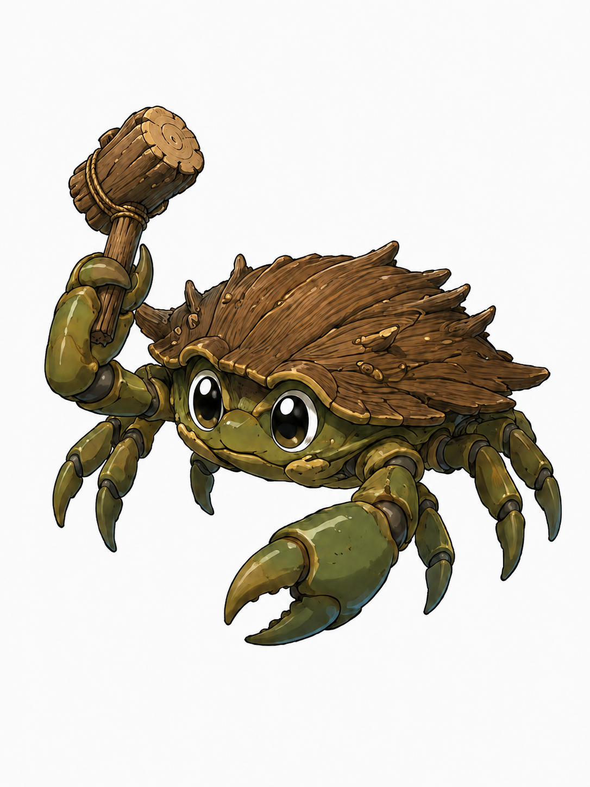

# Carapenter

> Concept record created September 3, 2026. Carapenter is the approved pure Grass-type second evolution of Palmit and was integrated into the game on the same date.

## Concept Summary

- **Name:** Carapenter
- **Name concept:** _Carapace_ + _carpenter_, joining its newly hardened shell to its apprenticeship in wooden shipbuilding
- **Final ID:** `carapenter`
- **Typing:** Grass
- **Evolutionary stage:** Second stage of the Palmit family
- **Creature basis:** A broad, low freshwater crab with a naturally grown exoskeleton
- **External inspiration:** A mature coconut's brown fibrous husk, hand-built wooden tools, and an apprentice shipwright learning to repair vessels
- **Evolution family:** Palmit evolves into Carapenter at level 16; Carapenter may later branch into either a noble shipwright final evolution or a cursed Grass/Ghost final evolution, whose names and designs remain open
- **Core concept:** A young freshwater crab that no longer hides inside a coconut because its own carapace has hardened into a protective, husk-like shell, allowing it to train in seawater and turn its old survival stick into its first shipwright's mallet.
- **Signature silhouette:** A low, wide crab beneath a backward-swept mass of layered brown husk plates, with one claw lifting an oversized handmade wooden mallet and the other held forward.

## Character and Story Hook

Carapenter should feel earnest, capable, and newly independent. Palmit survived by withdrawing into a found coconut; Carapenter now exposes its face and limbs, trusting the strength of its own shell for the first time. The pride in its raised mallet is real, but so is the vulnerability beneath it: it is training to endure seawater rather than having mastered it already.

Its central contradiction is that it wants to prove it no longer needs to hide, yet it can still push itself beyond what its freshwater body can safely withstand. The species repeatedly tests loose planks, driftwood, and damaged hulls with its mallet, then braces the material with its free claw while making simple repairs. This turns the shipwright idea into a repeatable behavior rather than a costume.

The mallet grows directly from Palmit's old relationship with its stick. It is not generic equipment: shaping that first piece of protective driftwood into a useful tool is the visible act that separates Carapenter's apprenticeship from Palmit's dependence on shelter.

## Inspiration

Crabs grow by molting their rigid exoskeleton. The replacement shell is initially soft and leaves the crab vulnerable before it hardens, providing a real biological foundation for a lineage about moving from exposed softness toward self-protective armor.

- [NOAA Fisheries: Alaska Shellfish Growth Research](https://www.fisheries.noaa.gov/alaska/science-data/alaska-shellfish-growth-research)
- [Smithsonian Environmental Research Center: Blue Crab Nursery Hot-Spots](https://serc.si.edu/blue-crabs-and-fishery/identifying-blue-crab-nursery-hot-spots)

Kew describes coconut fruit as ranging from green or yellow to brown, with a fibrous husk and thick inner shell. Coconut-husk fibre is also used for rope and other practical materials. Those traits support Carapenter's maturing palette, layered texture, and link between plant material and useful craft.

- [Kew Science, Plants of the World Online: _Cocos_](https://powo.science.kew.org/taxon/urn%3Alsid%3Aipni.org%3Anames%3A30009198-2/general-information)
- [Kew: Coconut palm](https://www.kew.org/plants/coconut-palm)

Traditional shipwrights maintain and restore wooden vessels by selecting, shaping, fitting, and fastening large timbers with specialized tools. This craft progression informs Carapenter's apprentice behavior and the proposed noble final evolution.

- [Mystic Seaport Museum: Henry B. du Pont Preservation Shipyard](https://mysticseaport.org/explore/henry-b-du-pont-preservation-shipyard/)
- [Mystic Seaport Museum: Mayflower II Big Timber Work](https://mysticseaport.org/news/mayflower-ii-spring-2017-update/)

The following are fictional Cosmoids-world extrapolations rather than claims about real crabs, coconuts, or shipwrights:

- a crab's natural carapace developing the color, grain, and layered fibres of a mature coconut husk;
- remaining pure Grass type after leaving the coconut shelter;
- freshwater tolerance being trained through controlled exposure to seawater;
- reshaping Palmit's carried stick into an inherited wooden mallet;
- work as an apprentice shipwright being a species-level behavior;
- the noble shipwright and drowning-related Grass/Ghost evolutionary branches.

## Fusion Logic

`freshwater crab molt and shell hardening + maturing coconut husk + apprentice shipwright craft + leaving protective shelter -> an exposed young crab whose own armor and first handmade tool mark growing independence`

The coconut idea moves from an inhabited object to embodied anatomy: its broad shell is not another coconut worn on its back, but a natural carapace whose brown layered grain recalls the protection it once borrowed. The same transition reshapes its behavior, palette, silhouette, tool use, emotional arc, and position between Palmit and the two possible final outcomes.

## Signature Vignette

Carapenter lifts its handmade mallet with one claw while planting its larger free claw beside a loose plank, ready to knock the timber back into place. Its wide eyes and raised posture show proud determination rather than mastery: this is the moment an anxious castaway begins behaving like an apprentice builder.

The approved standalone concept image captures the raised-mallet portion of this action. Future journal art or animation may introduce the plank or ship repair, but should not replace the mallet or obscure the exposed crab body.

## Visual Direction

- Low, broad adolescent crab anatomy in a lively three-quarter pose.
- The crab is fully outside the coconut; no spherical coconut body, worn coconut shell, or replacement enclosure.
- Wide natural carapace built from layered, backward-swept, chestnut-brown plates with fibrous wood-and-husk grain.
- Golden ochre edging separates the shell from the olive body and gives the plates a hardened, mature read.
- Olive and moss-green face, claws, and segmented legs with charcoal joints and restrained cool teal shadows.
- Large glossy black oval eyes with white highlights, giving it a youthful, earnest, approachable expression.
- One claw on the viewer's left raised overhead around a rough wooden mallet; the larger free claw projects toward the viewer on the right.
- Mallet head made from a bundled section of natural wood, with visible growth rings, bark-like texture, and coir-colored rope bindings.
- The mallet should feel handmade from Palmit's former stick rather than manufactured, metal-reinforced, or weapon-like.
- Restrained scuffs, knots, and short fibre ridges; no extra tools, costume, hat, armor, backpack, or decorative debris.
- Clean white or off-white concept background with no emphasis ticks, motion marks, scenery, floor plane, or cast shadow.

The approved concept image is the visual authority. Future production art may change the viewing angle to reveal anatomy, but it must preserve the checklist below and remain recognizably the same creature.

## Approved Identity Checklist

- **Silhouette:** A very low, wide crab dominated by a broad wedge of swept-back husk plates, counterbalanced by the high vertical mallet.
- **Body plan and proportions:** Flattened adolescent crab torso; face tucked beneath the front shell rim; two oversized claws; six clearly visible segmented walking legs arranged three per side.
- **Head and face:** Smooth olive face with a small friendly mouth line and subtle cheek forms beneath the brow-like shell edge.
- **Eye design:** Two very large glossy black oval eyes with bright white upper highlights and thin pale rims; open, earnest, and alert rather than fierce.
- **Appendage placement:** Tool-bearing claw raised on the viewer's left, larger open pincer projecting forward on the viewer's right, and walking legs fanning low from both sides.
- **Signature anatomy:** A natural carapace composed of overlapping fibrous plates that taper into irregular backward points; it must not read as a whole coconut or removable shell.
- **Signature object relationship:** One oversized handmade wooden mallet held securely in the raised claw, with a bark-textured handle, bundled-log head, and simple fibre bindings.
- **Palette:** Chestnut, umber, and golden ochre shell; olive and moss-green body; charcoal outlines and joints; tiny cool teal shadow accents; creamy white background.
- **Markings:** Wood-grain striations, small knots, restrained golden nicks and highlights on the shell; sparse scuffs and specks on the limbs.
- **Materials:** Smooth hard crab exoskeleton, dry fibrous husk-like carapace plates, rough natural wood, and twisted coir-like binding.
- **Shape rhythm:** Long backward shell strokes and tapered points contrast with the round eyes, chunky claws, cylindrical mallet head, and repeating curved leg segments.

## Evolutionary and Story Premise

Palmit begins as a vulnerable freshwater crab that hides inside a hollow coconut to keep salty seawater away while crossing between islands. It carries a simple stick because survival comes before craftsmanship.

Carapenter marks the family's transition from borrowed protection to self-reliance. After a growth stage, its own carapace hardens into layered brown armour reminiscent of a mature coconut husk. It leaves the coconut behind, reshapes the stick into a wooden mallet, and practices simple repairs while gradually testing how long it can remain in seawater. It is safer and more capable than Palmit, but its adaptation is incomplete.

On the noble path, patience, good judgment, and care for its crew can turn the apprentice into a master shipwright. The final form should make vessels seaworthy and use craft to protect others, completing the movement from hiding inside a boat-like coconut to building true ships.

On the cursed path, Carapenter pushes its seawater training too far and begins to drown before evolving. The proposed Grass/Ghost final form should turn unfinished craft, wreckage, and sea growth into a tragic inversion of the same ambition. The exact event, name, visual design, and branch trigger remain deliberately unresolved.

## Project Sources and Story Placement

- `src/constants/creatures.ts` verifies Palmit's name, pure Grass typing, freshwater-crab basis, coconut boat, and saltwater-protection premise.
- `COSMOID_CONCEPTS.md` verifies the existing family arc from improving sailor to a third-stage death and ghost-pirate outcome.
- `public/battles/cosmoids/palmit_down_1.png` is the current in-game visual reference for Palmit's green coconut shelter and carried stick.
- The user-directed lineage adds Carapenter's seawater training, noble shipwright destination, and drowning-related cursed Grass/Ghost branch.
- **Story placement:** One capturable level-10 Carapenter appears in Level 5, `The Caged Claw`, on the central path of `level_5_placeholder_wave`.

## Design Tests to Preserve

- **Ten-word read:** Coconut-sheltered crab grows husk armor and becomes a shipwright apprentice.
- **Five-second read:** Wide brown husk shell, huge eyes, green claws, raised mallet.
- **Silhouette read:** Low swept shell crossed by one tall handmade tool.
- **Character contradiction:** Proud to leave shelter, but not yet safe in seawater.
- **One surprise:** The coconut's protection has become its own natural carapace.

## Creation Record

- **Direction selected:** Exposed crab with an embodied mature-husk carapace
- **Concept selected:** Comparison option 1's layered shell and overall identity, revised with option 8's handmade wooden mallet
- **Visual approval date:** September 3, 2026
- **Final-name approval date:** September 3, 2026
- **Final ID:** `carapenter`
- **Concept-art file:** `docs/cosmoids/images/carapenter-concept.png`
- **Image status:** Approved standalone visual identity reference; stray emphasis ticks removed before approval
- **Game icon:** `public/UI/Icons/carapenter_icon.png`
- **Directional battle art:** `public/battles/cosmoids/carapenter_left.png`, `carapenter_up.png`, and `carapenter_down.png`
- **Creature manifest:** `src/content/creatures/carapenter.json`
- **Implementation status:** Production icon, corrected two-claw directional battle art, Grass gameplay data, Palmit's level-16 evolution node, TD visuals, and one capturable Level 5 encounter implemented

## Open Decisions

- Raise or revise the current gameplay level cap before Palmit can naturally reach its level-16 evolution threshold.
- Name, design, and type the noble shipwright final evolution.
- Name and finalize the cursed Grass/Ghost evolution inspired by drowning and unfinished shipcraft.
- Define the exact noble and cursed branch conditions without losing player agency or the story's emotional clarity.
- Revisit Carapenter's bulky physical Grass stats, learnset, scale, and TD offsets after playtesting.
- Decide its longer-term relationship to a crew or shipyard beyond the current Level 5 wild encounter.
- Determine whether controlled seawater training has a visible behavior, environmental interaction, or gameplay expression.
- Create its journal scene after its observed habitat behavior is finalized.
