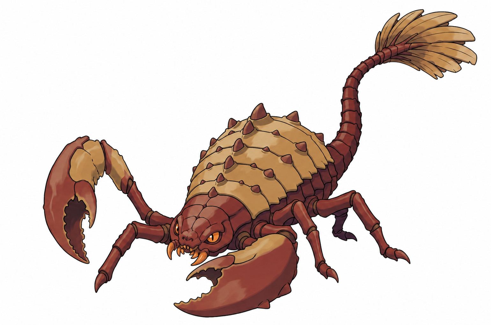

# Corrogoon

> Concept record finalized August 30, 2026. Corrogoon's production game assets, creature registry entry, manifest, Level 5 prisoner definition, and captive-ally behavior are implemented.

## Concept Summary

- **Name:** Corrogoon
- **Name concept:** Corrosion or corrode + vinegaroon, connecting its real animal basis to its ability to scour protective surfaces from metal
- **Typing:** Poison/Ground
- **Creature basis:** Vinegaroon, also called a whip scorpion
- **External inspiration:** Abrasive blasting, corrosion, and microbiologically influenced corrosion
- **Story placement:** Captive Cosmoid in Level 5's Ironbell Navy prison
- **Core concept:** A powerful burrowing vinegaroon that combines its acidic defensive secretion with loose grit, creating a poisonous abrasive slurry that scours protective surfaces from metal.
- **Signature silhouette:** A low, heavy arachnid with enormous shovel-shaped pedipalps and a broad biological fan at the end of its whip tail.

## Character and Story Hook

Corrogoon is a determined, slightly mischievous excavator that treats hard barriers as irresistible digging challenges. It gathers loose mineral grit with its oversized pedipalps, saturates the grit with its defensive secretion, and lashes the mixture forward with its tail fan.

The behavior is species-level rather than unique to the Level 5 prisoner. Its Poison typing comes through the secretion, while its Ground typing is expressed through burrowing, mineral gathering, and the abrasive grit suspended in the spray.

The Level 5 Corrogoon has been confined by the Ironbell Navy and can be released by the player. Once free, it turns its characteristic barrier-scouring behavior against Tigrevel's main cell gate.

## Inspiration

Real vinegaroons are arachnids with prominent pedipalps, six walking legs, a pair of specialized sensory legs, and a flexible whip-like tail. They can accurately spray a defensive secretion containing concentrated acetic acid. Caprylic acid in the secretion helps its droplets spread across and penetrate protective surfaces.

- [University of Florida: giant vinegaroon overview](https://ask.ifas.ufl.edu/publication/IN890)
- [Journal of Insect Physiology: composition and function of vinegaroon spray](https://www.sciencedirect.com/science/article/abs/pii/0022191061900543)

Metal deterioration is a fictional extrapolation grounded in microbiologically influenced corrosion. Real microbial biofilms can alter the chemistry immediately against a metal surface, produce acids, and accelerate localized corrosion.

- [US EPA: microbiologically influenced corrosion](https://nepis.epa.gov/Exe/ZyPURL.cgi?Dockey=P1005PMH.TXT)

The abrasive-grit slurry, tail-fan delivery, barrier-fixated temperament, and ability to damage steel structures are fictional design extrapolations. Together they form the creative bridge between the vinegaroon biology, Poison/Ground typing, and Level 5 role.

## Signature Behavior and Vignette

Corrogoon crouches low beside a stubborn barrier, scoops loose grit inward with its shovel-like pedipalps, and curls its whip tail overhead. Its fan spreads open just before it lashes a focused burst of acid-soaked grit across the surface, then it watches with a mischievous, satisfied stare as the coating begins to wear away.

This action should guide future animations and gameplay telegraphing. The creature should read as an inventive biological excavator, not as a conventional scorpion firing poison from a stinger.

## Visual Direction and Identity Lock

The approved concept image is the visual identity authority for future production assets. Preserve these features:

- Low, broad, heavily armored arachnid silhouette with a triangular forward weight.
- Six sturdy walking legs and two enormous shovel-shaped digging pedipalps.
- Broad, layered ochre and baked-clay dorsal plates with irregular dark-brown ridges and short conical spikes.
- Rust-red head, pincers, tail, and legs with warm tan upper surfaces and a dark charcoal underside.
- Low reptilian-arachnid head with determined amber eyes, a short ridged snout, and small orange mouthparts.
- Long segmented whip tail curled upward and ending in one fan of overlapping, leaflike tan chitin plates.
- No insect-like antennae, threadlike forehead feelers, true scorpion stinger, venom bulb, equipment, manufactured nozzle, or extra tail appendages.
- Approximately the size of a medium dog.

Future imagery may show magenta secretion and restrained acid-green gland accents when the action requires them, but the approved standalone concept deliberately shows only the creature on a clean white background. Do not add dirt piles, loose stones, poison streams, splashes, droplets, scenery, or a cast shadow to the identity-reference image.

The production icon and directional sprites follow the project's smooth painted 2D battle-art direction while preserving the approved silhouette, proportions, face, appendage placement, palette, markings, materials, and shovel-pincer and tail-fan shape rhythm at gameplay scale. The rear sprite keeps the tail visibly attached to the center of the rear abdomen rather than the head or shell edge.

## Level 5 Gameplay Intent

Corrogoon is one of several optional prisoners the player can release while trying to free Tigrevel. Every released prisoner should contribute directly to breaking the main cell gate.

After its cell opens, Corrogoon travels to Tigrevel's gate and launches acid-soaked grit at every living hostile creature and surviving gate on the battlefield every six seconds. Each impact applies **Scoured** for ten seconds. Scoured deals 4 Poison damage every two seconds and reduces both Defense and Special Defense by 25%; later volleys refresh the timer without stacking the reduction.

Scoured deliberately works on normally status-immune structures. This lets Corrogoon erode Tigrevel's bars while also creating chain breakouts: if the damage-over-time effect destroys another prisoner gate, that gate's normal release sequence runs. Towers and freed objective allies are excluded from the volley.

This makes Corrogoon valuable without making it the sole solution: every captive joins the breach effort, while each brings a different secondary benefit.

## Design Tests to Preserve

- **Ten-word read:** A burrowing vinegaroon scours barriers with acid-soaked mineral grit.
- **Five-second read:** Shovel pincers gather grit; the raised tail fan lashes it.
- **Silhouette read:** Low armored wedge, enormous pedipalps, curled fan-tipped whip tail.
- **Character contradiction:** Heavy and intimidating, but visibly delighted by a difficult excavation.
- **One surprise:** Its tail ends in a biological fan that spreads abrasive spray.

## Creation Record

- **Initial working name:** Scourgar
- **Final name selected:** Corrogoon
- **Name selection date:** August 30, 2026
- **Production integration date:** August 31, 2026
- **Concept-art file:** `docs/cosmoids/images/corrogoon-concept.png`
- **Game icon:** `apps/web/public/UI/Icons/corrogoon_icon.png`
- **Directional battle art:** `apps/web/public/battles/cosmoids/corrogoon_left.png`, `corrogoon_up.png`, and `corrogoon_down.png`
- **Creature manifest:** `apps/web/src/content/creatures/corrogoon.json`
- **Image status:** Approved standalone visual identity and production game assets implemented
- **Initial gameplay profile:** Poison/Ground type; slow armored bruiser; starts with Pinch, learns Tackle at level 4, and learns Nibble at level 7

## Open Decisions

- Decide whether Corrogoon is a single-stage species or part of an evolutionary family.
- Define its broader habitat and species ecology outside the Ironbell Navy prison.
- Create journal artwork after its broader habitat and observed wild behavior are finalized.
