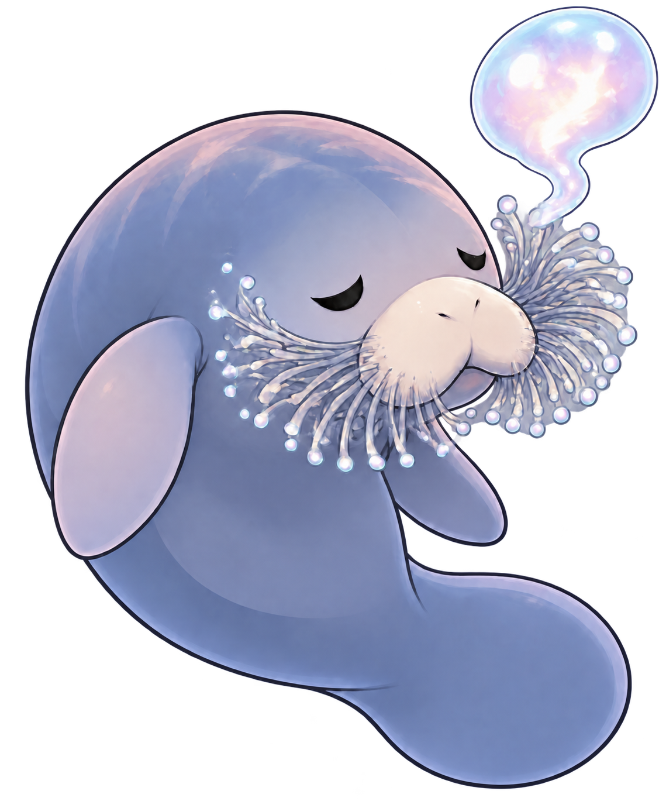

# Dormatee

> Updated September 18, 2026. The name, standalone visual identity, Psychic typing, icon, directional battle assets, species registration, and initial gameplay defaults are complete. Custom dream techniques and the Level 7 encounter remain open.

## Concept Summary

- **Name:** Dormatee
- **ID:** `dormatee`
- **Name concept:** _Dormire_ ("to sleep") or _dormant_ + _manatee_, giving the name a simple, warmly sleepy sound.
- **Typing:** Psychic
- **Creature basis:** Florida or West Indian manatee, especially its suspended resting posture and unusually extensive tactile whiskers.
- **External inspiration:** Shared dreams, communal rest, and sleep as a safe refuge.
- **Story placement:** Proposed rare wildlife encounter for Level 7, a peaceful island stop with no required objective and no loss condition.
- **Core concept:** A rare Psychic manatee whose naps calm an entire lagoon. Its dense whiskers connect nearby sleeping minds into one gentle shared dream.
- **Signature silhouette:** A large, rounded blue-lavender manatee curled into a floating resting pose, framed by a radiant fan of pearl-tipped whiskers and one small dream orb.

## Character and Story Hook

Dormatee is a lovable, heavy sleeper that unintentionally invites nearby creatures into the same peaceful dream. It is soothing rather than mysterious or threatening: resting wildlife naturally gathers around it, turning a quiet lagoon into a temporary dream community.

Its central contradiction is that its greatest ability works while it is unconscious. Dormatee may settle somewhere for a private nap, only to wake surrounded by creatures that felt safe enough to sleep beside it. That makes it a natural fit for a level about pausing the adventure and simply spending time with island wildlife.

## Inspiration and Fictional Translation

Florida manatees may rest while suspended near the surface or while lying on the bottom in shallow water. They can spend several hours a day resting and surface less frequently for air while inactive. These observations inform Dormatee's buoyant, unhurried resting posture and its preference for sheltered water. [Florida Fish and Wildlife Conservation Commission: Florida Manatee](https://myfwc.com/wildlifehabitats/profiles/mammals/aquatic/florida-manatee/)

Manatees possess specialized facial and body vibrissae, and research indicates that the dense bristles around the mouth have important tactile and food-handling functions. This sensory biology informs the design's unusually prominent whisker fan. [University of Florida: Manatee Neurobiology](https://aquatic.vetmed.ufl.edu/research/manatee/neurobiology/) [Reep et al.: Microanatomy of facial vibrissae in the Florida manatee](https://pubmed.ncbi.nlm.nih.gov/11799274/)

**Creative bridge:** A resting manatee + an exceptionally sensitive whisker system + the emotional safety of communal sleep -> a Psychic creature whose whiskers gently link nearby sleeping minds.

Shared dreaming, psychic links, pearl-tipped sensory whiskers, and a visible dream orb are fictional Cosmoid abilities. They are not claims about real manatees or aquatic-mammal sleep. General aquatic-mammal sleep research is background inspiration only. [Sleep in Aquatic Mammals](https://pmc.ncbi.nlm.nih.gov/articles/PMC8665646/)

## Signature Behavior and Vignette

Dormatee curls beneath the calm surface of a sheltered lagoon and slowly drifts to sleep. Its long whiskers spread like a soft sensory net, and exactly one pearly orb rises from them on a thin wisp of vapor. Nearby Cosmoids grow quiet, settle into comfortable resting places, and begin sharing the same gentle dream.

This vignette establishes Dormatee's character and visual language, not a required battle effect. The dream orb should remain a singular, restrained accent rather than becoming a cloud of magical particles.

## Visual Direction and Identity Lock

The approved standalone image above is the visual identity authority. Preserve it when generating an icon, directional sprites, journal art, or later illustrations:

- Large, rounded, domed manatee body with the head and torso flowing together in one compact curled pose.
- Broad paddle tail curving toward the lower screen-right side.
- One large oval screen-left flipper with a pink-lavender inner surface and one smaller screen-right flipper.
- Pale cream, two-lobed bulbous muzzle with tiny nostrils; closed black crescent eyes, a relaxed closed mouth, and an unmistakably sleepy, peaceful expression.
- An unusually dense fan of long, fine silver-lavender tactile whiskers radiating from the muzzle and lower face, each ending in a small pearl-like tip.
- Exactly one softly translucent, pearly dream orb above and behind the screen-right whisker fan, connected by one wispy vapor trail.
- Muted slate-blue and dusty blue-lavender skin, pale cream muzzle, pink-lavender flipper interior, silver-lavender whiskers, and an opalescent pink-blue-cream orb.
- Mostly unpatterned smooth skin with subtle cool highlights. No belly crease, belly patch, scar, seam, symbols, gems, clothing, armor, or added accessories.
- Calm nested curves lead from the body dome through the eyes, muzzle, whisker fan, and tail.
- The overall impression is lovable, sleepy, safe, soothing, and unintentionally magical.

Preserve the reference's proportions, facial structure, appendage count, palette, whisker density, orb count, and curled silhouette through changes of viewing angle. Use the project's smooth painted 2D battle-art finish for production assets. The concept image has a transparent background and should remain unchanged as the approved standalone reference.

## Level 7 Story and Encounter Intent

Level 7 is intended as a relaxing island stop where the crew stretches their legs. It has no required objective and no loss condition; the player is free to explore, encounter wildlife, and catch creatures without an urgent conflict driving the visit.

Dormatee is proposed as one of the level's rarer discoveries, most naturally found in the quietest sheltered lagoon. Its presence should reinforce the level's restful tone rather than introduce a villain, crisis, or mandatory challenge. The player may catch it or leave it sleeping. Exact spawning, rarity, capture tuning, and any optional environmental interaction remain undecided.

## Provisional Gameplay Ideas

The ideas below are brainstorming candidates, not approved attacks, abilities, or implementation requirements. Their shared direction is a very slow, bulky Psychic support and control role: Dormatee influences a battle by resting, calming allies, and gradually making enemies drowsy rather than by dealing overwhelming direct damage.

- **Dream Network:** Psychic attacks apply stacks of Drowsy. Drowsy slows an enemy's movement and attacks; enough stacks briefly put it to sleep. A recently awakened target would receive temporary resistance to prevent continuous sleep-locking, while bosses could resist sleep but retain the slowdown.
- **Dream Pearl:** Dormatee releases its single pearly orb for moderate Psychic damage and applies multiple Drowsy stacks to one target.
- **Whisker Wave:** Its sensory whiskers send a short Psychic ripple through a group, dealing light damage and applying Drowsy to each affected enemy.
- **Deep Rest:** Dormatee curls up and stops attacking for several seconds, restores some health, and sends calming pulses that slow nearby enemies. It gains a temporary protective barrier when it wakes.
- **Shared Reverie:** Dormatee links several enemies inside one dream so that part of the damage dealt to any linked target echoes to the others as Psychic damage.
- **Gentle Presence:** A passive calming aura slightly reduces damage received by nearby allies.
- **Startled Awakening:** If Dormatee is struck during Deep Rest, its dream orb bursts, pushes nearby enemies away, and wakes it immediately.
- **Body Rush:** A possible basic Normal attack that uses Dormatee's heavy floating body and gives it a simple option outside its Psychic techniques.

One possible initial kit is Body Rush, Dream Pearl, Dream Network, and Deep Rest, with Shared Reverie reserved as a later signature technique. This combination is only a reference package; individual ideas may be selected, revised, combined, or discarded later.

## Production Integration

Dormatee is registered as the game's first Psychic-type species. Psychic has its own UI and battle-effect colors, and its initial type interactions follow the familiar creature-battling relationships currently supported by the game's type roster: Psychic is strong against Poison, resisted by Psychic and Steel, and ineffective against Dark; Bug and Dark are strong against Psychic.

The current gameplay values establish Dormatee as a very slow, specially defensive support-oriented species without committing to the provisional dream mechanics:

- **Base stats:** HP 86, Attack 42, Defense 70, Special Attack 76, Special Defense 90, Speed 18.
- **Base experience:** 82.
- **Movement profile:** Existing `lizard` profile as an integration default pending bespoke floating movement.
- **Placeholder attacks:** Body Rush (`TACKLE`) at level 1 and String Shot (`STRING_SHOT`) at level 4. String Shot temporarily represents a whisker-based slowing option; neither move locks the final Psychic kit.
- **Story placement:** Recorded as a planned rare Level 7 encounter. No Level 7 runtime configuration or wave placement exists yet, so Dormatee has not been inserted into another level as a substitute.

Production assets:

- `apps/web/public/UI/Icons/dormatee_icon.png` — 160x160 tight head-and-face icon.
- `apps/web/public/battles/cosmoids/dormatee_left.png` — 360x240 left-facing sprite; the right-facing view mirrors this asset.
- `apps/web/public/battles/cosmoids/dormatee_down.png` — 200x275 direct-front sprite.
- `apps/web/public/battles/cosmoids/dormatee_up.png` — 200x275 direct-rear sprite.
- `apps/web/src/content/creatures/dormatee.json` — dated creature manifest and planned Level 7 placement record.

## Creation Record

- **Final name selected:** Dormatee
- **Name and concept documentation date:** September 18, 2026
- **Concept-art file:** `docs/cosmoids/images/dormatee-concept.png`
- **Approved source image:** `reveratee_standalone_preview-v2.png`
- **Visual selection:** Psychic concept 6, refined into a standalone resting manatee; the final revision removed the unintended crease line across its belly.
- **Image status:** Approved standalone concept, copied unchanged from the final generated source. Production assets were generated as identity-preserving directional derivatives.
- **Production asset sources:** Icon `exec-9c0c5e92-76fe-4674-b729-6889d070d482.png`; left `exec-68fb2e45-f7ac-49c3-9afe-97b0b80a9464.png`; down `exec-1106f397-6c1c-4fe7-9cc4-3f192e3090ba.png`; up `exec-18a4e4da-2a29-45ec-baef-8f257a6757b2.png`.
- **Production status:** Icon, left/down/up battle sprites, Psychic element support, species registry entry, directional configuration, gameplay defaults, focused Psychic test, and dated creature manifest are implemented. Right-facing visuals mirror the left sprite. Level 7 and custom dream attacks remain planned.
- **Provisional scale:** Approximately 1.4 meters long was suggested during concept development but is not yet locked.

## Open Decisions

- Decide Dormatee's exact rarity, spawn conditions, and capture tuning in Level 7.
- Decide whether the shared-dream premise receives a gameplay effect or remains primarily behavioral and narrative.
- Select, revise, combine, or reject the provisional gameplay ideas before implementing any attacks or abilities.
- Replace or approve the placeholder attacks after selecting Dormatee's final dream techniques.
- Tune the initial stats, scale, offsets, movement, animation needs, and broader battle role during Level 7 development.
- Decide whether Dormatee is a single-stage species or belongs to an evolutionary family.
- Lock its physical size, broader habitat, diet, distribution, and ecology beyond the quiet lagoon premise.
- Define Level 7's map, optional interactions, creature roster, and exit flow without compromising its no-objective, cannot-lose structure.
- Create journal artwork through the dedicated journal-art workflow when requested.
