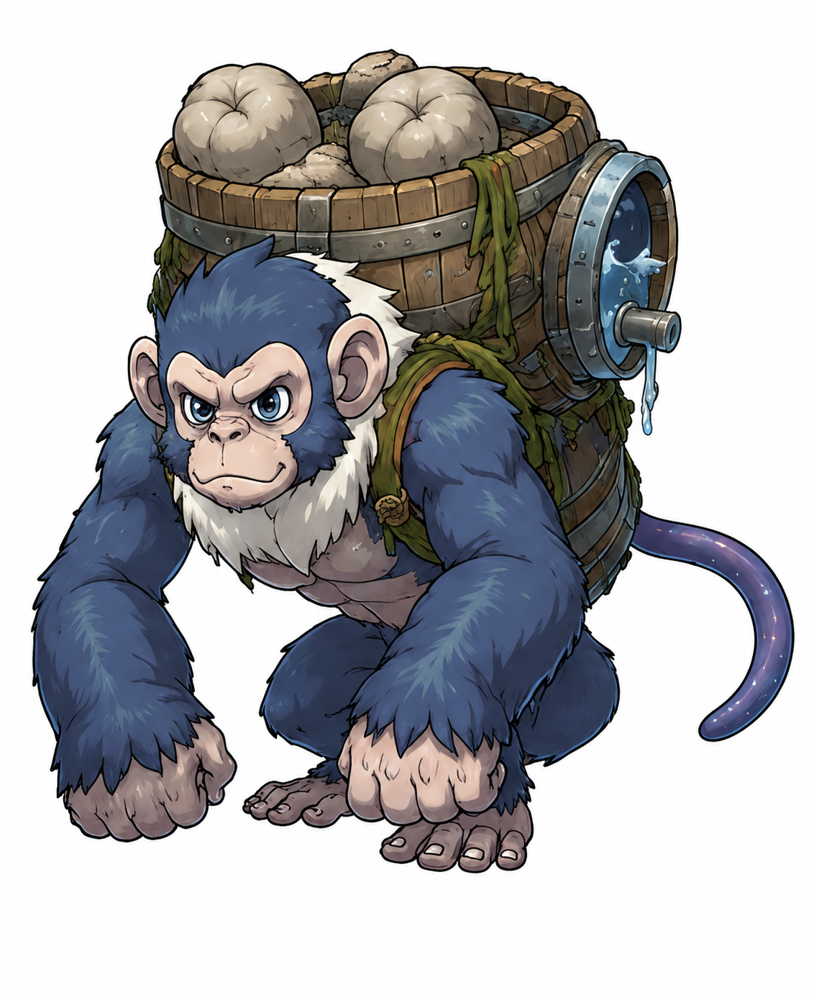

# Macask

> Concept record created September 3, 2026. Macask is the approved pure Water-type second evolution of Monkeg and was integrated into the game on the same date. Its finalized name was updated September 4, 2026.

## Concept Summary

- **Name:** Macask
- **Name concept:** _Macaque_ + _cask_, joining the species' coastal-primate basis to the barrel it carries for its crew
- **Final ID:** `macask`
- **Typing:** Water
- **Evolutionary stage:** Second stage of the Monkeg family
- **Creature basis:** A macaque-like maritime primate, with long-tailed macaques as the principal real-world behavioral anchor
- **External inspiration:** Shipboard deck labor, cargo porters, weighted training, and wooden provision casks
- **Evolution family:** Monkeg -> Macask -> either the noble Astrolape branch or a cursed final branch whose name and final design remain open
- **Core concept:** A former barrel-hiding stowaway that now wears its barrel as a heavy utility backpack, building wisdom and strength by voluntarily carrying the crew's most difficult loads.
- **Signature silhouette:** A broad, low adolescent sea ape with oversized forearms and gripping feet beneath a towering cargo-filled barrel backpack, balanced by one clean curling cosmic tail.

## Character and Story Hook

Macask should feel capable, dependable, and quietly proud. It is still an apprentice rather than a captain, but it has stopped waiting for danger to pass from inside its barrel. It now steps forward when work needs to be done and seeks out the heaviest load before another crewmate can take it.

Its central contradiction is that its confidence comes from being useful, while privately it worries that one failed delivery will make its crew stop depending on it. Macask rarely admits that a load is too heavy. That persistence can mature into calm service and judgment, but it also leaves the species vulnerable to handlers who exploit its need to prove itself.

The barrel is not interchangeable luggage or a sailor costume. It is the same species-defining shelter used by Monkeg, repurposed into a weighted utility pack as the creature matures. Removing that relationship would remove Macask's silhouette, characteristic behavior, emotional arc, and connection to both final branches.

## Inspiration

Long-tailed macaques (_Macaca fascicularis_) inhabit coastal, mangrove, swamp, and riverine forests. Coastal populations forage in intertidal areas and use stones to process marine foods. Research has also found that they select tool mass according to the food being processed, providing a useful behavioral foundation for Macask's dexterity, coastal life, and sensitivity to carried weight.

- [University of Wisconsin Primate Info Net: Long-tailed macaque](https://primate.wisc.edu/primate-info-net/pin-factsheets/pin-factsheet-long-tailed-macaque/)
- [PubMed: Stone-tool usage by Thai long-tailed macaques](https://pubmed.ncbi.nlm.nih.gov/17146796/)
- [Royal Society study: Long-tailed macaques select tool mass according to food type](https://pmc.ncbi.nlm.nih.gov/articles/PMC4027418/)

Wooden casks made from fitted staves and hoops were essential shipboard containers. They carried provisions, cargo, liquids, and catches at sea, and some ships carried loose components so barrels could be assembled when required.

- [Mystic Seaport Museum: Cooperage](https://mysticseaport.org/explore/village-old/cooperage/)
- [Smithsonian National Museum of American History: A Pirate's Gear](https://americanhistory.si.edu/explore/exhibitions/on-the-water/online/living-atlantic-world/pirates/gear)

The following elements are fictional Cosmoids-world extrapolations rather than claims about real macaques or historical deck work:

- a translucent cosmic tail whose stars respond to shifting cargo;
- using an inherited barrel as weighted training equipment and a wearable utility pack;
- the barrel's side-mounted water chamber and spigot;
- elemental Water typing;
- the connection between voluntary labor, noble evolution, cursed exploitation, and the two final branches.

## Fusion Logic

`coastal tool-using macaque + shipboard cargo cask + chosen burden as emotional growth -> a broad young deckhand that turns its former hiding place into the weight through which it earns strength and responsibility`

The cask changes Macask's silhouette, posture, locomotion, behavior, social role, training method, evolutionary story, and name. Its large hands, low center of gravity, strong limbs, and balancing tail all develop around carrying that particular object rather than serving as unrelated primate traits.

## Signature Vignette

Macask strides across a pitching deck beneath a barrel packed with supplies. When one bundle begins to slip, the stars in its cosmic tail brighten near the loose load and the tail steadies it without Macask breaking pace. Its expression remains focused and confident: the effort is visible, but so is its satisfaction at being trusted.

The approved standalone concept image captures the resting moment immediately before or after this action. Future animation and journal art may show the moving cargo more explicitly without attaching a weight, bundle, ornament, tool, or other object to the tail tip.

## Visual Direction

- Broad, squat adolescent maritime-primate anatomy in a low forward-working stance.
- Compact torso, thick thighs, oversized long forearms, and large gripping hands and feet.
- Strong enough to look dependable, but visibly younger, smaller, and less commanding than either final evolution.
- Ocean-blue fur with restrained lighter blue highlights.
- Warm pale muzzle, hands, and feet; dusty mauve skin around the ears and torso.
- Angular pale face mask, rounded ears, blue crown tuft, cream cheek fur, and a full cream neck ruff.
- Large blue-gray eyes beneath strong brows, creating a stern but capable and confident expression rather than anger.
- One large wooden barrel worn high on the back through a simple green seaweed harness.
- Open barrel top containing three pale tied supply sacks and a small amount of loose packing material.
- Dark steel hoops, a round side-mounted barrel head, and one short metal-rimmed bung or spigot with restrained water drips.
- Small amounts of hanging seaweed soften the manufactured barrel geometry and connect it to long use at sea.
- Exactly one translucent indigo-to-cyan cosmic tail with restrained star points and a clean, unobstructed, naturally rounded taper.
- No object, knot, barrel, bundle, weight, ornament, tool, or cargo attached to the tail tip.
- No sailor hat, coat, uniform, weapon, random utility belt, or additional handheld equipment.
- Approximately 1.1 metres tall when fully upright, although its habitual load-bearing posture makes it appear lower and broader.

The concept image is the visual authority. Future production art may change viewing angle to reveal anatomy, but it must preserve the identity checklist below and remain recognizably the same creature.

## Approved Identity Checklist

- **Silhouette:** Low forward-leaning primate beneath a towering round barrel, with two heavy forearm columns and one simple tail arc balancing the rear.
- **Body plan and proportions:** Compact adolescent torso; broad shoulders; thick thighs; extremely long, muscular forearms; large hands and feet; head smaller than the combined barrel-and-shoulder mass.
- **Head and face:** Angular pale muzzle and brow field, blue facial mask and crown tuft, rounded protruding ears, cream cheek fur, and a full pointed cream ruff.
- **Eye design:** Large blue-gray eyes with dark upper rims and small bright highlights; focused and self-assured rather than feral.
- **Appendages:** Exactly two arms, two legs, two ears, and one cosmic tail emerging behind the creature's right side.
- **Signature object relationship:** One large cargo barrel worn as an indispensable backpack through a seaweed harness; the barrel is neither body armor nor a torso shell.
- **Barrel contents:** Three pale tied supply sacks remain visible at the open top; no loose cargo sits outside the pack in the approved standalone design.
- **Palette:** Deep ocean and slate blues; warm cream; dusty mauve; medium and dark brown wood; cool gray steel; olive seaweed green; indigo, violet, and cyan tail accents.
- **Markings:** Lighter blue fur strokes on the limbs and crown, an angular pale facial field, cream ruff and cheek masses, and restrained star points inside the translucent tail.
- **Materials:** Soft stylized fur, smooth skin, aged wooden staves, riveted metal hoops, damp flexible seaweed, cloth supply sacks, water, and a glassy-translucent cosmic tail.
- **Shape rhythm:** Huge rounded barrel and forearms dominate; angular brow and fur tufts provide tension; hoop arcs, sack circles, tail curve, and rounded fingers repeat the load-bearing forms.

## Evolutionary and Story Premise

Monkeg begins as a shy stowaway that hides inside a barrel and uses its cosmic tail as a rudder. Macask leaves that shelter, straps it to its back, and turns passive safety into a responsibility it voluntarily carries. Its ordinary deck labor is the family stage where physical strength, practical wisdom, and moral direction are earned.

On the noble path, Macask learns that strength exists to reduce the burdens of others. Its experience carrying provisions, balancing on moving decks, and observing how a crew depends on one another matures into Astrolape's calm authority and navigation. The barrel can later be adapted into Astrolape's barrel-derived equipment without becoming arbitrary armor.

On the cursed path, exploitative handlers can take advantage of Macask's refusal to admit weakness by loading its pack with cursed salvage or relics. Responsibility becomes unbearable coercion, and its fear of disappointing the crew is twisted into furious overexertion. The cursed final evolution may destroy or abandon the barrel, turning the loss of its chosen burden into a visible rejection of trust and service.

## Design Tests to Preserve

- **Ten-word read:** A powerful young deckhand carries its former shelter for others.
- **Five-second read:** Bulky blue ape, enormous supply barrel, confident working stance, cosmic tail.
- **Silhouette read:** Broad forearms and towering backpack balanced by one clean tail curve.
- **Character contradiction:** Confident because it is useful, but afraid to admit exhaustion.
- **One surprise:** The hiding barrel has become the weight that trains it.

## Creation Record

- **Direction selected:** Barrel-as-weighted-utility-pack deckhand direction
- **Concept selected:** Detailed concept batch option 3, revised to combine option 1's dependable cargo-runner theme with option 3's bulky silhouette
- **Visual approval date:** September 3, 2026
- **Final-name approval date:** September 4, 2026
- **Final ID:** `macask`
- **Concept-art file:** `docs/cosmoids/images/macask-concept.png`
- **Image status:** Approved standalone visual identity reference; tail-tip cargo removed before approval
- **Implementation status:** Production icon, directional battle art, creation record, registry entry, reused attack set, stats, level-12 evolution from Monkeg, and a capturable level-10 Level 5 encounter implemented. Journal art and both final branches remain open.

## Open Decisions

- Finalize the cursed third evolution's name and approved design.
- Confirm Astrolape's final typing and the cursed branch's exact typing.
- Define the future branch evolution methods and the precise role of cursed relic exposure.
- Decide whether a particular crew demonstrates Macask's healthy or exploitative path beyond its current Level 5 wild encounter.
- Revisit balance after playtesting its bulky physical Water stat line and existing attack set.
- Decide whether the barrel's water chamber and spigot have a specific battle or traversal function.
- Develop Macask's journal scene through the dedicated journal-art workflow.
