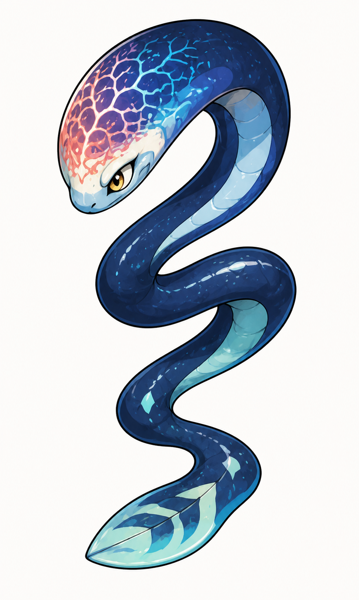

# Marophis

> Concept record finalized September 1, 2026. Marophis is an approved Poison/Water wild creature with production assets, registry data, and a capturable Level 5 introduction.

## Concept Summary

- **Name:** Marophis
- **Name concept:** _Marine_ or _mare_ (sea) + _ophis_ (snake), identifying it as an elegant sea serpent
- **Typing:** Poison/Water
- **Creature basis:** True sea snakes, especially the annulated sea snake, combined with the predatory behavior of the tentacled snake
- **External inspiration:** A living dive timer whose vascular color drains from warm coral toward cool blue as stored breath runs low
- **Story placement:** Intended as a wild species for Level 5's wet underground environment rather than one of its prisoners
- **Core concept:** A patient deep-diving venomous snake that holds its breath for extraordinary periods and uses a precise body feint to trick startled prey into swimming toward its mouth.
- **Signature silhouette:** A long midnight-blue serpent arranged in a vertical S-curve, dominated by an oversized rounded vascular crown and ending in a broad leaflike paddle tail.

## Character and Ecological Hook

Marophis should feel composed, watchful, and slightly uncanny. Its contradiction is that it appears almost completely motionless while hunting, yet that stillness conceals a calculating predator that manipulates the prey's own escape reflex.

It descends into deep flooded caverns and waits in a loose J-shaped coil. When a fish enters the correct position, Marophis makes a small, precisely timed body feint that startles the fish toward its waiting mouth. Its enlarged vascular crown begins warm coral near the face after surfacing and gradually cools through lavender and cyan toward deep blue during a dive, visibly suggesting how much breath remains.

## Signature Behavior and Vignette

A Marophis hangs nearly motionless in a dark underwater passage, its body bent into a patient hook and the coral glow across its crown slowly cooling. At the last moment, it twitches the middle of its body rather than lunging immediately, sending a startled fish directly toward its mouth.

The memorable behavior is not a frantic chase or lure that resembles prey. Marophis calmly positions itself so that a victim's instinctive escape response completes the hunt for it.

## Real-World Inspiration

Verified traits that informed Marophis include:

- True sea snakes have laterally compressed bodies and paddle-shaped tails that aid swimming.
- Sea snakes are capable breath-holders; documented individuals have dived beyond 200 metres, and they can supplement lung oxygen by absorbing some oxygen through their skin.
- The annulated sea snake (_Hydrophis cyanocinctus_) has a dense network of veins across its forehead and snout that probably helps supply its brain with oxygen during long dives.
- The fully aquatic tentacled snake (_Erpeton tentaculatum_) hunts fish from a J-shaped posture and uses a body feint to trigger an escape response that directs prey toward its strike.

Sources:

- [Natural History Museum: sea snakes, sea kraits, and their aquatic adaptations](https://www.nhm.ac.uk/discover/sea-snakes-sea-kraits-and-their-aquatic-adaptations.html)
- [Vanderbilt University Catania Lab: tentacled snakes](https://as.vanderbilt.edu/catanialab/research/tentacled-snakes/)

The following are fictional Cosmoids-world extrapolations rather than claims about real snakes:

- one species combining true sea-snake diving adaptations with the tentacled snake's prey-directing feint;
- the greatly enlarged translucent vascular crown;
- the crown functioning as a visible color-changing breath countdown;
- Poison/Water elemental biology;
- its habitat and encounter role in Level 5's flooded underground environment.

## Fusion Logic

`deep-diving sea snake + tentacled snake escape-response hunting + vascular dive-timer metaphor -> a patient aquatic serpent whose body feint turns fleeing prey toward its mouth while its crown displays its remaining breath`

The fusion determines Marophis's hunting posture, signature action, oversized head silhouette, visible vascular pattern, paddle tail, underwater habitat, and Poison/Water typing.

## Visual Direction

- One long, limbless serpent held in a tall flowing S-curve with a clean, elegant silhouette.
- Oversized rounded teardrop or wedge-shaped head crown that reads as living translucent tissue rather than a hood, fin, helmet, or separate object.
- Crown color transitions from warm coral and salmon around the brow through lavender and bright cyan into deep ocean blue toward the rear.
- Large branching cyan, lavender, cream, and coral vascular lines spread across the crown, with restrained smaller speckles between them.
- Small pale cream lower face and snout nested beneath the crown, with a focused amber eye and dark angular eyelid.
- Midnight-navy body with smooth aquatic scales, scattered restrained blue speckles, and glossy painted highlights.
- Powder-blue segmented underside visible along the inward curves of the body.
- Broad leaflike paddle tail with mint-cyan geometric bands and a translucent aqua tip.
- In the down-facing battle view, the face and crown lead in the lower foreground while the body and paddle tail recede upward behind the head.
- The up-facing battle view reverses that depth order: the back of the crown leads toward the top of the screen while the body and tail trail toward the lower foreground.
- No limbs, tentacles, horns, external fins, cobra hood, equipment, jewelry, poison droplets, elemental aura, or scenery.
- The crown, face, main body curve, underside, and tail paddle must remain readable at approximately 64–128 pixels.

## Approved Identity Checklist

- **Silhouette:** Tall vertical S-shaped serpent with an enormous rounded crown at the top and a broad leaflike paddle tail at the bottom.
- **Body plan and proportions:** Exactly one long limbless body; the crown is substantially wider than the neck, the torso tapers gradually, and the tail expands into a flattened paddle.
- **Head and face:** Small pale wedge-shaped snout projecting from beneath the much larger rounded crown; no separate hood or jaw appendages.
- **Eye design:** One visible focused amber eye with a black pupil, bright highlight, cream surround, and strong dark upper lid.
- **Appendages:** No limbs, tentacles, horns, barbels, or external fins; one continuous body and one paddle tail.
- **Signature anatomy:** Oversized translucent vascular crown with branching capillary-like lines and a color gradient that functions as a fictional dive timer.
- **Palette:** Midnight navy and deep cobalt body; pale powder-blue underside; coral, salmon, lavender, cyan, and blue crown; mint-aqua tail accents; cream face; amber eye.
- **Markings:** Branching vascular network across the crown, sparse blue body speckles, small cyan highlights, and angular mint-cyan bands on the paddle tail.
- **Materials:** Smooth aquatic scales, softly translucent living crown tissue, glossy wet-looking highlights, and a flexible flattened tail paddle.
- **Shape rhythm:** One large rounded head mass flows into alternating broad and narrow S-curves before resolving in the pointed leaf shape of the tail.

The approved concept image is the visual authority. Future art may change the viewing angle to reveal anatomy, but it must preserve this checklist and remain recognizably the same species.

## Evolutionary and Story Premise

Marophis currently works as a single-stage wild species. Its complete identity comes from the tension between extraordinary patience and one sudden manipulative motion, while its crown makes the normally invisible limit of a deep dive visually legible.

If an evolutionary line is added later, it should advance or complicate the relationship between breath management, deceptive hunting, and the vascular crown rather than merely making Marophis larger or more venomous.

## Level 5 Gameplay Profile

Marophis is introduced as one capturable level-8 wild enemy on the right-hand approach in Level 5's current placeholder wave. Its slower movement and high special defense support the patient deep-diver concept without adding creature-specific engine behavior.

Its learnset begins with Nibble at level 1 and Spurt at level 4. At level 8 it learns Venom Spray, a direct-damage special Poison attack with one 50% poison roll per cast. A successful roll adds a five-second venom stack whose per-pulse potency is 5% of that cast's resolved direct damage, rounded to the nearest point with a minimum of one. Venom can hold up to five independently resolved stacks; another successful application at the cap refreshes its duration without adding a sixth stack. Its distinct venom poison can coexist with Toxic Pollen. At level 12 it learns Deepwater Grip. A dedicated prey-feint mechanic remains a possible future addition.

### Deepwater Grip

Implemented September 6, 2026 as a special Water attack focused on single-target control. Marophis holds one enemy for four seconds, dealing four equal, moderate damage pulses (20 power per pulse, once per second). It cannot use another attack during the hold, including when the player switches its selected move. The eight-second cooldown begins when the hold starts and uses simulation time; attack-speed buffs do not shorten it.

After release, the enemy resists all further constriction for six seconds, shared across every Marophis. Resistance has no battlefield indicator. Structures and status-immune enemies cannot be gripped. Removing or moving the caster, losing the target, or moving the target out of range ends the hold early. Existing poison continues independently.

The initial procedural visual places Marophis beside the target with smooth navy coils, pale underside highlights, a coral-to-blue crown glow, and a shrinking breath meter. These use existing battle sprites without changing the shipped art assets.

## Creation Record

- **Initial working name:** Breathglass
- **Final name selected:** Marophis
- **Visual approval date:** September 1, 2026
- **Final-name approval date:** September 1, 2026
- **Final ID:** `marophis`
- **Concept-art file:** `docs/cosmoids/images/marophis-concept.png`
- **Game icon:** `apps/web/public/UI/Icons/marophis_icon.png`
- **Directional battle art:** `apps/web/public/battles/cosmoids/marophis_left.webp`, `marophis_up.png`, and `marophis_down.png`
- **Journal art:** `apps/web/public/UI/Journal/marophis_journal.png` — resting in a loose horizontal coil while breathing from a flooded-cavern air pocket
- **Creature manifest:** `apps/web/src/content/creatures/marophis.json`
- **Image status:** Approved standalone visual identity, production game assets, and naturalist journal art implemented
- **Implementation status:** Registered Poison/Water Cosmoid; introduced as one capturable level-8 wild enemy in Level 5's current placeholder wave
- **Initial gameplay profile:** Special-defense specialist; starts with Nibble, learns Spurt at level 4, learns the 50%-proc stacking-poison attack Venom Spray at level 8, and learns Deepwater Grip at level 12

## Open Decisions

- Revisit Level 5's temporary single-wave placement, spawn count, and level when the complete wild-creature wave plan is authored.
- Decide whether its prey-directing body feint should eventually gain a dedicated ability or combat mechanic.
- Decide how the vascular crown's color change should appear in animation and whether it has a gameplay function.
- Decide whether Marophis remains single-stage or belongs to an evolutionary family.
