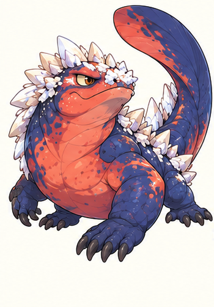

# Nautiguan

> Final name and base visual identity approved September 21, 2026. Production game assets, integration, and journal artwork completed September 22, 2026.

## Concept Summary

- **Name:** Nautiguan
- **Repository ID:** `nautiguan`
- **Name concept:** _Nautical_ + _iguana_, connecting its marine-iguana basis to the long voyages on which sailors value it.
- **Typing:** Water
- **Evolution stage:** Second and currently final stage; evolves from Aguana.
- **Biological basis:** Galápagos marine iguana (_Amblyrhynchus cristatus_), especially the subtidal foraging of larger individuals, flattened swimming tail, rock-gripping claws, and nasal salt glands.
- **External inspiration:** Shipboard salt reserves. Sailors collect the crystals Nautiguan expels after long dives, giving its real biological salt-removal system a practical place in the seafaring Cosmoids world.
- **Character core:** A powerful mature marine grazer whose species identity combines long cold-water dives, immovable footing, and a conspicuous salt crown; individual temperament remains open rather than being prescribed by the species concept.
- **Core concept:** A broad, heat-retaining Water-type marine iguana Cosmoid that dives far beyond Aguana's range, drives itself with a massive paddle tail, and forcefully expels salt gathered from seawater.
- **Signature silhouette:** A squat coral-red body braced on four massive indigo limbs, framed by a high curved paddle tail and a jagged white salt crown running from the head along the back.

## Cosmoid Entry

Its greater strength and heat-retaining body allow it to graze in deeper water for much longer. It spits excess salt collected from seawater, so sailors often bring one aboard and gather the crystals to replenish the ship's salt reserves.

## Inspiration and Fictional Translation

### Verified natural anchors

- The [Galápagos Conservancy's biodiversity profile](https://www.galapagos.org/about_galapagos/biodiversity/) describes the marine iguana's submerged algae grazing, blunt feeding snout, flattened swimming tail, cold-water limitation, and nasal glands that remove excess salt.
- A [field study indexed by PubMed](https://pubmed.ncbi.nlm.nih.gov/28313754/) found that larger marine iguanas forage subtidally while smaller animals feed in the intertidal zone. That size-linked ecological shift anchors the Aguana-to-Nautiguan evolution.
- Research on the species describes [rock gripping during feeding, dives of 12 metres or more, and some submergences lasting 30 minutes or more](https://www.sciencedirect.com/science/article/abs/pii/S1096495908000262), while noting that typical dives are shorter.
- Research published in _Nature_ documents [reversible shrinking under severe food shortage](https://www.nature.com/articles/47396), supporting the family's general growth-and-shrinkage direction.

### Creative bridge

Large marine-iguana subtidal foraging + salt expelled through the nostrils + the practical needs of long sea voyages -> a heavy second stage whose diving adaptations culminate in a salt-crystal crown that sailors can harvest.

### Fictional elements

Nautiguan's enormous salt crystals, ability to spit salt as a directed action, coral-and-indigo palette, deliberate service aboard ships, and salt-reserve tradition are fictional. Real marine iguanas expel salt, but the collection of their salt for shipboard stores is Cosmoids worldbuilding rather than a historical or zoological claim.

## Signature Behavior and Vignette

Nautiguan heaves itself onto a sun-warmed rock after a long dive, plants its claws, and blasts a concentrated spray of salt from its nostrils. As white crystals accumulate around its crown, nearby sailors carefully gather the excess into a storage jar.

This vignette establishes the family's mature ecological and social role without fixing Nautiguan to one individual personality or nature.

## Visual Direction and Identity Lock

The approved base image above is the visual identity authority for future Nautiguan artwork.

- **Silhouette:** Squat, broad, and heavy, with a massive rounded torso, four thick grounded limbs, a blunt head, a high jagged salt fringe, and a very broad tail rising in a strong curve behind the body.
- **Body plan and proportions:** Four-legged marine-reptile body with a low center of gravity. The belly and shoulders carry substantial mass, clearly contrasting with Aguana's elongated juvenile build.
- **Head and face:** Broad blunt wedge-shaped head, firm closed mouth, heavy brow, and a prominent golden-yellow eye with a narrow dark pupil. Preserve its composed, formidable facial read without assigning a universal temperament.
- **Feet and claws:** Four large feet with long dark claws that visibly support the adult's weight and communicate powerful anchoring on wave-swept rock.
- **Signature feature:** A dense chalk-white salt crown clustered across the brow, temples, cheeks, and upper neck, continuing into much larger crystalline shards along the back and toward the tail base.
- **Tail:** Oversized, vertically flattened paddle tail with an indigo outer surface, coral-red underside, and irregular coral markings. It rises behind the body as a major framing shape.
- **Palette:** Saturated coral-red across the face, throat, belly, and large portions of the limbs; deep indigo-blue across the limbs, back, and tail; golden-yellow eye; charcoal claws; bright chalk-white and faint lavender-blue salt crystals.
- **Markings:** Irregular indigo patches scatter across the coral body and coral patches interrupt the indigo limbs and tail. Preserve the organic asymmetry rather than replacing it with bands or a uniform gradient.
- **Materials:** Smooth stylized reptile skin, hard curved claws, and dry angular salt crystals. The salt should look mineral and brittle rather than icy or magical.
- **Shape language:** Heavy rounded body masses opposed by sharp crystalline triangles and one sweeping tail curve.
- **Rendering:** Original polished 2D creature-collection RPG art with clean dark outlines, controlled painted/cel shading, and an uncluttered pale background.
- **Prohibited drift:** Do not make the salt look like ice, add armor or ship equipment, slim the torso toward Aguana's proportions, reduce the paddle tail, replace the crystal fringe with ordinary reptile spines, or turn the creature into a realistic wildlife illustration.

## Evolutionary Premise

Nautiguan completes the ecological progression begun by Aguana. A small shoreline grazer becomes a heavy subtidal specialist: greater mass supports longer exposure to cold water, stronger claws hold against harsher currents, the larger tail supplies more force, and increasing salt intake produces the adult's crown and dorsal crystals.

The evolution is intentionally communicated through changed proportions, foraging range, and salt development—not by making Aguana a uniformly smaller copy of the adult.

## General Gameplay Direction

Nautiguan retains Aguana's **Warmth** family resource: a persistent radial 0-100% meter. After a non-Water move has remained active for one full second, it gains 10% Warmth per second; changing to a Water move stops generation and resets that delay. Switching between non-Water moves preserves the timer, and stored Warmth does not otherwise decay.

Any amount of Warmth grants its damaging Water attacks the full 40% damage bonus. A Water attack drains 10% once per activation after capturing that bonus, regardless of its projectile, target, hit, or pulse count. The level-4 `SUNBATHE` utility move fills the meter and grants **Sun-Soaked** on a persistent 45-second cooldown; Sun-Soaked makes the next empowered Water activation free. The adult's Water attacks will be designed later to develop this same resource through stronger or broader lane-shaping payoffs rather than adding another resource.

The approved level-5 `WAKE_WHIP` is a physical Water attack driven by the family's paddle tail. Nautiguan faces its target, waggles the tail, and launches a narrow wake that pushes the target backward; Warmth strengthens both damage and displacement. At level 16, `SALT_SPIT` replaces the placeholder Bubble Beam: Nautiguan fires physical salt-crystal projectiles that briefly stun. At 0% Warmth it fires at one target; with any Warmth it fires at up to three different targets. Each projectile deals full damage and can make an eligible carrier drop its objective once, with a short pickup lock. One volley drains 10% Warmth regardless of how many projectiles launch, and Sun-Soaked can waive that drain.

Approved biological sources for that next move-design pass include:

- Powerful anchoring claws
- A broad paddle tail used for propulsion and heavy strikes
- Directed salt expulsion or salt-spitting
- Greater strength and heat retention supporting longer dives

## Approved Stat Direction

Approved October 1, 2026: Nautiguan is a bulky physical Water attacker and the
family's currently final evolution. Evolution shifts Aguana's shoreline agility
into strength and staying power. Attack is its highest stat, supporting its
massive paddle tail, anchoring claws, and physical Salt Spit. Strong HP and
defense reflect its broad adult body, with solid special defense and a slight
physical defensive emphasis. Low speed and special attack preserve clear
limitations. Warmth supplies conditional offensive strength, while its physical
power and durability remain recognizable with shared or off-type moves.

[Drednaw](https://pokemondb.net/pokedex/drednaw) supplied the physical aquatic
reptile comparison; [Carracosta](https://pokemondb.net/pokedex/carracosta) supplied
the slow, heavy adult comparison. The approved direction favors a slower physical
attacker with more balanced defenses than a heavily shelled specialist.

The authored stats live only in
[`creatures.ts`](../../apps/web/src/constants/creatures.ts). This approval replaces
the initial integration defaults; encounter tuning remains a separate decision.

## Seafaring World Role

Some crews keep a Nautiguan aboard on long voyages and gather the crystals it expels after feeding. This gives the species a valued, repeatable relationship with sailors without adding tools, clothing, or a nautical costume to its anatomy.

The exact economics, prevalence, handling method, and story use of this salt-collecting practice remain open.

## Creation Record

- **Creation date:** September 21, 2026
- **Final name selected:** September 21, 2026
- **Concept development:** Selected as the adult from the first of five marine-iguana evolution pairs. Its heavy coral-and-indigo body, massive tail, powerful claws, and dramatic salt-crystal crown were preserved while the juvenile was redesigned to establish a distinct first-stage silhouette.
- **Approved concept image:** [`docs/cosmoids/images/nautiguan-concept.png`](./images/nautiguan-concept.png)
- **Image status:** Preserved unchanged from the selected full-body adult identity crop.
- **Family:** Aguana -> Nautiguan
- **Production date:** September 22, 2026
- **Production assets:** Tight portrait icon plus left, up, and down directional battle sprites, with PNG masters under `art-source/creatures` and transparency-preserving WebP derivatives in `apps/web/public`.
- **Gameplay implementation:** Pure Water type with the Warmth family resource and the approved October 1, 2026 bulky physical stat direction. Wake Whip and Salt Spit are the approved physical Water attacks; Deepwater Grip still awaits redesign. Current learnset and evolution requirements are owned by the species registry.
- **Story placement:** Evolution-only within the current Level 6 family integration; wild Nautiguan placement remains open.
- **Creation provenance:** [historical integration record](../art/CREATURE_PROVENANCE.md)
- **Journal observation:** In strong underwater currents, a mature Nautiguan braces itself against the flow like a living breakwater while a young Aguana clings to the shelter of its flank. The adult looks back to check on the juvenile as loose seaweed and bubbles stream past them.
- **Journal artwork:** [`art-source/creatures/journal/nautiguan_journal.png`](../../art-source/creatures/journal/nautiguan_journal.png), published at `/UI/Journal/nautiguan_journal.webp`.
- **Production status:** Integrated into the creature registry, evolution data, tower-defense visuals, journal, and creation record.

## Open Decisions

- Exact physical scale and diving limits in Cosmoids lore
- Replacement for provisional `DEEPWATER_GRIP` and final adult Warmth balance
- Mechanical treatment of anchoring and reversible size change
- Wild habitat distribution, rarity, capture rules, and direct story placement
- How common the shipboard salt-harvesting relationship is

Individual natures or personality variants are intentionally outside this species-concept record.
