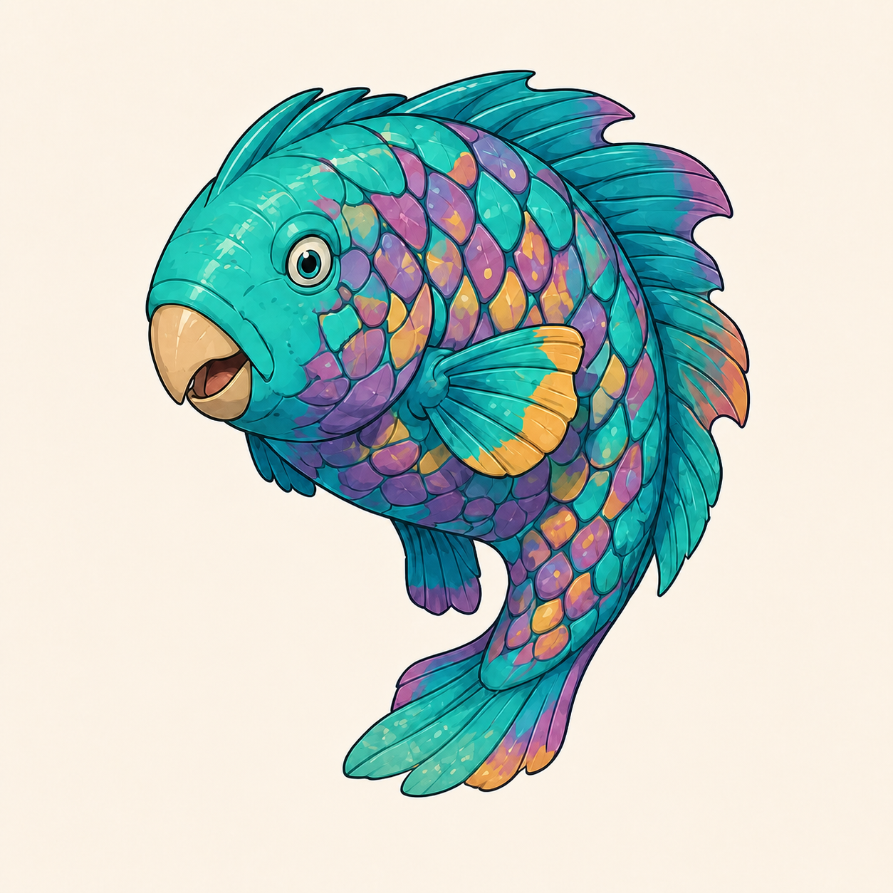

# Parlet

> Concept record created August 30, 2026. Parlet is the selected Water-type prisoner direction for Level 5 and is registered as a game Cosmoid with production battle assets and a captive-ally behavior.

## Concept Summary

- **Name:** Parlet
- **Name concept:** _Parrotfish_ + _palette_, connecting its animal basis with its instinctive artistry
- **Typing:** Water
- **Creature basis:** Parrotfish
- **External inspiration:** Mosaic craft, tesserae, murals that change over time, and the frustration of an artist who never considers a work finished
- **Story placement:** Captive Cosmoid encountered in Level 5's Ironbell Navy prison
- **Core concept:** A proud reef artist whose overlapping scales continuously rearrange their colors into living mosaic patterns, but whose perfectionism causes it to revise every design almost as soon as it is complete.
- **Signature silhouette:** A compact, nearly round parrotfish with a blunt cream beak, a high layered dorsal fin, a short tail, and broad overlapping scales organized into colorful irregular patches.

## Character and Story Hook

Parlet should feel proud, stubborn, and slightly comical. It takes its artwork completely seriously, but it is incapable of leaving a pattern alone. Even after creating something beautiful, it notices one misplaced color, circles back, and begins revising the entire design.

The behavior is species-level rather than a personal profession. Parlet instinctively responds to the colors and textures of reefs, ruins, boats, and coastal structures by reorganizing the patterns across its own scales. It may then scrape nearby mineral surfaces with its beak, producing pale sand and arranging the disturbed colors into temporary murals.

This particular Parlet finds itself in the Level 5 prison after drawing unwanted Navy attention. A possible explanation is that it repeatedly altered or covered an official Navy insignia because it considered the composition unfinished. That incident is story flavor, not the source of its anatomy or abilities, and may be revised when the prisoner encounters are written.

## Inspiration

Parrotfish possess fused dental plates that form a strong beak. They graze reef surfaces, grind ingested coral material, and return much of it to the environment as fine sand. Parrotfish species and life phases can also display strikingly different color patterns.

- [Smithsonian Ocean: Tough Teeth and Parrotfish Poop](https://ocean.si.edu/ocean-life/fish/tough-teeth-and-parrotfish-poop)
- [Smithsonian Tropical Research Institute: Parrotfishes](https://biogeodb.stri.si.edu/sftep/en/thefishes/taxon/1686)

Mosaics form larger images from individually placed pieces called tesserae. Their color, spacing, orientation, and relationship to surrounding pieces determine the complete image.

- [Smithsonian National Museum of Asian Art: Mosaic tessera](https://asia-archive.si.edu/object/F1909.491/)

Parlet's moving scale patterns are a fictional extrapolation. The conceptual bridge treats each broad overlapping scale as part of a living palette while the fish's grazing, sand production, changing coloration, artistic temperament, and Water typing combine into one repeatable behavior.

## Signature Vignette

Parlet finishes a colorful pattern across its flank and turns proudly to inspect it. Its satisfaction lasts only a moment: one eye fixes on an imperfect patch, its short pectoral fin stiffens, and it circles back to rearrange the design again.

The vignette should guide future animation and journal artwork without requiring a literal wall, canvas, paintbrush, or artist costume. Parlet is the artwork and the artist at the same time.

## Visual Direction

- Compact, chunky, nearly round parrotfish anatomy with the head and torso reading as one stout mass.
- Simple fishlike face with one modest round visible eye and a mildly proud, stubborn expression.
- No eyebrows, eyelashes, humanlike facial makeup, or humanoid hand gestures.
- Medium-sized blunt cream beak rather than a large hooked bird bill.
- Turquoise and teal as the dominant body colors.
- Broad overlapping biological scales in irregular purple, magenta, warm-yellow, and turquoise patches.
- Scales remain soft-edged and integrated into the skin; they are not tiles, gemstones, armor plates, or detached pieces.
- High but compact layered dorsal fin, short rounded pectoral fins, and a compact tail.
- Strong color grouping and a clean silhouette that remain readable at approximately 64–128 pixels.
- Approximately the size of a large reef fish.
- No tools, clothing, jewelry, paint supplies, literal mosaic fragments, or persistent sand effects.

The approved concept reference intentionally omits the curved sand trail that appeared during exploration. Future art should preserve the clean creature silhouette on its own. Small sand particles may appear only when a specific animation or scene clearly calls for Parlet's grazing behavior.

## Level 5 Story Intent

Parlet occupies one of the optional cells connected to Level 5's paths. Its identity should not be built around opening cells or damaging Tigrevel's gate; it is a complete Water-type species that simply happens to have been imprisoned when the crew encounters it.

Opening Parlet's cell reveals its personality through an immediate act of composition. It travels toward Tigrevel's cell and paints a shifting mosaic current over each enemy approach. The currents slow enemies, periodically push them opposite their direction of travel, and send synchronized colored Water crests into the main gate. Parlet remains beside the objective maintaining and endlessly revising the patterns.

## Design Tests to Preserve

- **Ten-word read:** A perfectionist parrotfish that rearranges its scales into living mosaics.
- **Five-second read:** Proud inspection, one visible flaw, immediate frustrated revision.
- **Silhouette read:** Compact round fish, blunt beak, layered fins, broad patterned scales.
- **Character contradiction:** A gifted artist that cannot allow any artwork to remain finished.
- **One surprise:** Its own scales act as the endlessly changing mosaic.

## Creation Record

- **Concept selected:** Water-type Level 5 prisoner exploration, option 9
- **Selection date:** August 30, 2026
- **Name selected:** Parlet (_parrotfish_ + _palette_)
- **Concept-art file:** `docs/cosmoids/images/parlet-concept.png`
- **Production assets:** `public/UI/Icons/parlet_icon.png` and `public/battles/cosmoids/parlet_{left,up,down}.png`
- **Creature manifest:** `src/content/creatures/parlet.json`
- **Image status:** Cleaned approved direction and production game assets implemented; exploratory curved sand trail removed
- **Implementation status:** Registered Water-type game Cosmoid with a Level 5 captive-ally route, persistent mosaic-current battlefield support, and synchronized gate damage

## Open Decisions

- Decide whether it is a single-stage species or begins an evolution story about learning when to preserve a finished creation.
- Decide why the Navy imprisoned this particular Parlet and how much of that explanation appears during Level 5.
- Create journal artwork after its habitat and observed wild behavior are finalized.
