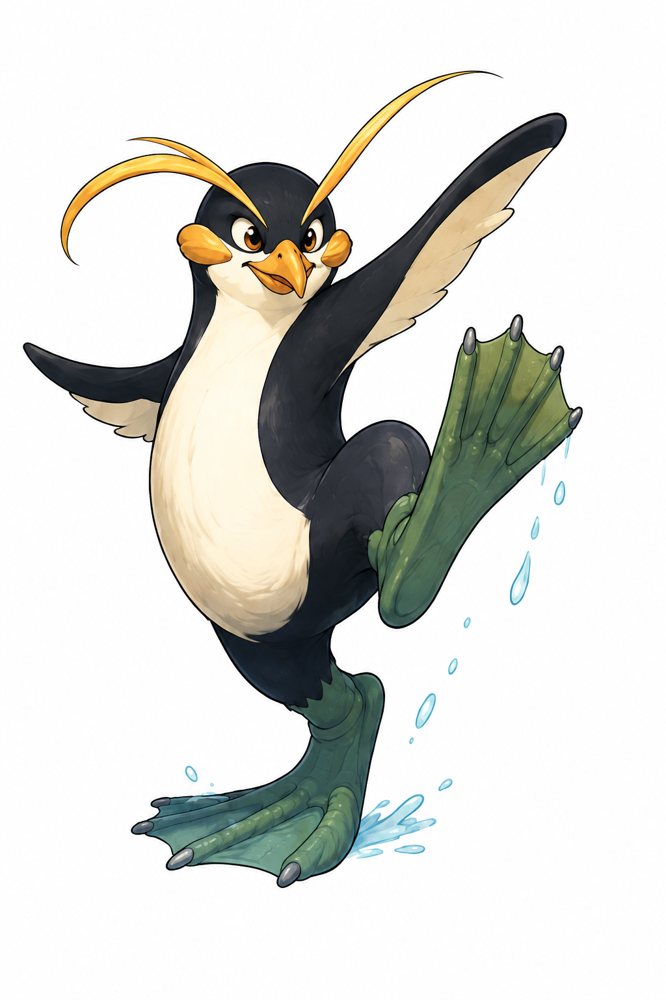

# Poguin

> Concept and final name recorded September 7, 2026. The user selected penguin concept 9, approved its existing appearance without changes, and chose Poguin as its final name. Production assets were completed September 8, 2026; Level 6 implementation remains pending.

## Concept Summary

- **Name:** Poguin
- **ID:** `poguin`
- **Name concept:** Pogo + penguin, pronounced "POH-gwin"; the name connects its springy jumping with its animal basis.
- **Typing:** Electric/Water
- **Evolutionary stage:** Stage 1, with room for a future evolution; no evolved form or evolution requirement is approved.
- **Creature basis:** Rockhopper and other crested penguins, with emperor penguin group movement as a separate behavioral inspiration.
- **External inspiration:** Dance, shared rhythm, pogo-like bouncing, and useful cooperation turned into a performance.
- **Story placement:** Selected supporting enemy direction for the Ironbell Navy officer's recapture effort in [Level 6](../levels/level-6.md).
- **Core concept:** An exuberant penguin whose oversized webbed feet turn rhythmic hopping and stamping into charged splashes and coordinated group movement.
- **Signature silhouette:** Slim upright body, sweeping golden eyebrow plumes, and enormous green webbed feet in an expressive dancing pose.

## Character and Story Hook

Poguin is an enthusiastic show-off: it enjoys helping its companions but cannot resist turning useful work into a performance. Its oversized feet, buoyant posture, and swinging plumes should communicate delight and confidence before electrical effects are added.

Its repeatable behavior is rhythmic footwork. Small hops build toward a more emphatic landing; nearby Poguin can pick up the rhythm. Rockhopper-style two-footed jumping extends this behavior without changing the approved anatomy, palette, or standalone pose.

In Level 6, the officer could exploit this cooperative instinct to coordinate the effort to drag Tigrevel back into captivity. Navy service belongs to the encounter, not to every member of the species. Detailed hauling and boss interactions remain proposals, not implemented or fully approved mechanics.

## Inspiration and Fictional Translation

- Rockhopper penguins jump with their feet together. This supports the two-footed leap and landing, rather than requiring flight or an Ice typing. [Louisville Zoo: Rockhopper penguin fact sheet](https://louisvillezoo.org/wp-content/uploads/2014/06/Penguin-Rockhopper.pdf)
- Penguin anatomy supplies webbed feet, swimming flippers, protective plumage, and the crested-penguin visual foundation. [Smithsonian Ocean: Penguins](https://ocean.si.edu/ocean-life/seabirds/penguins)
- Researchers observed small coordinated steps propagating through emperor penguin huddles. This is a separate species' behavior used as inspiration, not a claim that rockhoppers perform synchronized dances. [Coordinated Movements Prevent Jamming in an Emperor Penguin Huddle](https://journals.plos.org/plosone/article?id=10.1371/journal.pone.0020260)

**Creative bridge:** Rockhopper jumping + penguin webbed feet + coordinated group movement + dance and bouncing -> an expressive penguin whose rhythmic landings move charged water and bring companions into step.

Electrical storage in wet soles, charged splashes, musical choreography, and rhythmic hauling boosts are fictional Cosmoid ideas. The dance is a character metaphor, not a claim about penguin biology. No precise physical explanation, numerical jump height, or real-world dance tradition has been established.

## Signature Behavior and Vignette

The approved concept shows Poguin balancing on one foot, lifting the other toward the viewer, and spreading its flippers in an exuberant dance gesture. Its long eyebrow plumes follow the movement, while droplets trail from the raised foot.

For later animation, the proposed phrase is **hop, hop, stomp**: two small hops, a pronounced crouch with feet together, and a heavier two-footed landing that releases charged spray. The current standalone image remains unchanged; the jumping concept guides animation rather than redesign.

## Visual Direction and Identity Lock

The standalone image above preserves the selected ninth creature from the ensemble and is the reference for future production work. The user's explicit instruction was to keep its current look unchanged.

- Preserve the slender upright torso, small rounded head, curved chest, and springy penguin proportions. Do not turn it into a squat baby penguin or bulky armored commander.
- Keep the charcoal-black head, back, flippers, thighs, and tail; warm cream face, throat, belly, and inner-flipper feather areas; golden-orange bill and cheek tufts; and muted sage/olive-green feet.
- Preserve the expressive amber-brown eyes, black pupils, pale eye surrounds, small pointed beak, and confident, playful expression.
- Keep the two main sweeping golden eyebrow-plume groups, their long curved tapered shapes, and the small branching detail visible in the reference. Do not replace them with lightning spikes, a crown, or extra crest ornaments.
- Preserve exactly two flippers and two legs. The flippers have dark upper surfaces and cream feathered undersides; their visible feather edges remain soft and organic.
- Keep the enormous broad webbed feet, pronounced longitudinal ridges, organic skin shading, and small dark gray claw tips. Preserve the reference's toe arrangement through changes of angle; do not add fingers or convert the feet into shoes, paddles, or tools.
- In this concept pose, the screen-right foot is raised with its sole visible and the other foot bears the weight. The screen-right flipper reaches diagonally upward; the opposite flipper extends outward and back.
- Retain the small dark rear tail and the penguin body plan when completing hidden anatomy in other views.
- The small water droplets and supporting-foot splash belong to the concept's action. No lightning symbols, new body markings, navy uniform, equipment, or Ice motifs are approved.
- Maintain smooth antialiased outlines, controlled painted/cel shading, readable value groups, and the restrained feather detail of the reference.

Naming and rockhopper inspiration must not alter the selected appearance. The white concept background is not a transparent production sprite. Later directional views and animation may change pose while preserving identity.

## Level 6 Gameplay Direction

Poguin is the selected Electric/Water penguin minion concept alongside Steel/Electric Voltusk. The encounter's existing moving objective remains Tigrevel in the officer's separate steel net.

The user endorsed rockhopper jumping as an additional source for the level. The following translations were discussed and remain candidates for encounter design:

- Short hops carry Poguin toward a hauling position.
- A clearly visible crouch and gathering charge warn of a heavier two-footed stomp.
- A stomp releases an electrical splash; near the net, its beat could cue a coordinated pull.
- Multiple Poguin could synchronize, making a gathering group more dangerous.
- Interrupting the windup could prevent the next coordinated action.
- Voltusk's cursed-phase surges could force a faster, increasingly frantic rhythm while retaining a readable warning.

Do not infer approved attack IDs, damage, movement speed, invulnerability during jumps, terrain bypass, stun rules, pulse timing, or hauling progress from these notes. Final mechanics need implementation and balance decisions. The officer forces Voltusk into a Cursed Aura state by unidentified means; Poguin has no approved independent cursed form or evolution.

## Approved Stat Direction

Approved October 1, 2026: Poguin is a lightly built stage-one creature whose
speed and charged splashes are its main strengths. Speed is its highest stat,
followed by special attack. Its oversized feet still support useful physical
attacks, while modest HP and defenses provide a meaningful limitation and leave
room for evolution. These tendencies preserve its agile identity when using
shared or off-type moves.

[Piplup](https://pokemondb.net/pokedex/piplup) supplied the unevolved penguin
comparison, [Chinchou](https://pokemondb.net/pokedex/chinchou) the Electric/Water
comparison, and [Buizel](https://pokemondb.net/pokedex/buizel) the energetic aquatic
movement comparison. The approved spread emphasizes agility over Piplup's bulk
and special attacks over Buizel's physical emphasis.

The authored stats live only in
[`creatures.ts`](../../apps/web/src/constants/creatures.ts). This approval
replaces the initial integration defaults; Level 6 encounter multipliers still
require separate balance evaluation.

## Creation Record

- **Selection and final naming date:** September 7, 2026.
- **Visual selection:** Concept 9 of the ten Electric/Water penguins; original appearance explicitly retained.
- **Earlier working label:** Jigawatt, superseded by Poguin; not the final species name.
- **Ensemble source:** `exec-66a5d9cf-8106-479c-9f53-2b50e2692d84.png`, bottom row, fourth creature from the left.
- **Standalone source:** `exec-63f1a6d6-2ae6-4b0f-ac92-2019ebd357dc.png`.
- **Concept-art file:** `docs/cosmoids/images/poguin-concept.png`, copied unchanged from the standalone source.
- **Image generation:** Built-in imagegen; standalone extraction/enlargement used the selected ensemble as its visual reference.
- **Production assets:** `apps/web/public/UI/Icons/poguin_icon.png`, `apps/web/public/battles/cosmoids/poguin_left.webp`, `poguin_down.png`, and `poguin_up.png`.
- **Production status:** Icon, directional battle sprites, creation record, species registry entry, reused attacks, and tower-defense visuals completed September 8, 2026. Story-level placement and bespoke gameplay behavior remain pending.

## Open Decisions

- Finalize the species description, habitat, physical size, and ecology beyond the selected character and movement ideas.
- Design Poguin's future evolution and decide its evolution requirement; its stage-one status is approved.
- Decide whether hopping is a movement presentation, an attack, a terrain interaction, or a combination, and define its readable counters.
- Resolve group synchronization, hauling effects, interactions with Voltusk, wave composition, and balance in Level 6.
- Decide capture availability and progression.
- Develop journal art separately through the journal-art workflow when requested.
