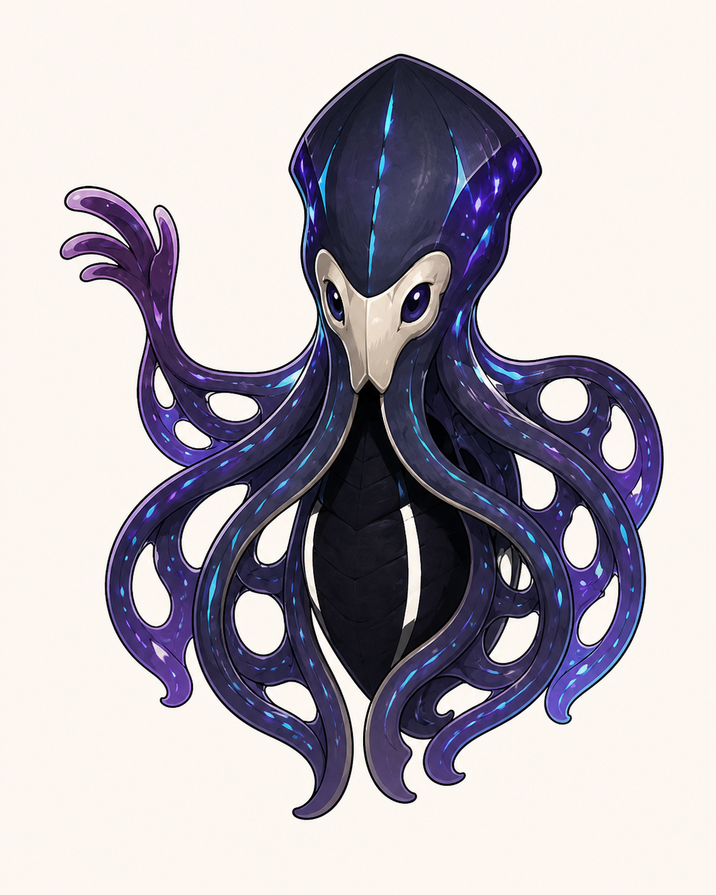

# Sepippet

> Concept record created August 30, 2026. Sepippet is the selected Dark-type prisoner direction for Level 5 and is registered as a game Cosmoid with production battle assets. Its planned captive-ally behavior may still change.

## Concept Summary

- **Name:** Sepippet
- **Typing:** Dark
- **Creature basis:** Cuttlefish
- **External inspiration:** Shadow-puppet theatre, misdirection, and backstage mechanisms
- **Story placement:** Captive Cosmoid in Level 5's Ironbell Navy prison
- **Core concept:** A theatrical infiltrator that creates animated silhouettes as distractions while its own flattened shadow-arms slip through narrow openings and manipulate mechanisms from the other side.
- **Signature silhouette:** An upright cuttlefish with a tall pointed mantle and eight flowing ribbon arms with sparse openings; only one arm ends in a subtly hand-like organic fan.

## Character and Story Hook

Sepippet is an elegant show-off determined to make every escape look like a perfectly rehearsed performance. It wants to appear mysterious and composed, but one excitable arm habitually waves at the audience, points out the trick, or celebrates too early.

The contradiction keeps it playful rather than sinister: Sepippet is genuinely talented at deception, but too enthusiastic to preserve its own mystique. It treats locked cells as stages and frightened prisoners as an audience that deserves a hopeful ending.

The Navy imprisoned this Sepippet after it repeatedly projected convincing guard silhouettes, redirected patrols, and opened holding cells from outside their keyways. Navy reports disagree about how many Sepippets were involved because every witness claims to have chased a different one.

## Inspiration

Cuttlefish can rapidly change visible patterns through pigment-containing chromatophores. The same biological system supports camouflage as well as conspicuous visual displays.

- [Monterey Bay Aquarium: Cephalopods and chromatophores](https://www.montereybayaquarium.org/animals-the-ocean/animals-a-to-z/cephalopods)

Traditional shadow-puppet theatre creates the illusion of animated figures by manipulating shaped silhouettes between a light source and a screen. Some traditions use articulated figures controlled through rods.

- [UNESCO: Chinese shadow puppetry](https://ich.unesco.org/en/RL/chinese-shadow-puppetry-00421)

Sepippet's solid, independently useful shadow-arms are a fictional extrapolation. The conceptual bridge turns a cuttlefish's changeable skin, flexible arms, camouflage, and visual signaling into a species-level relationship with projected silhouettes and theatrical misdirection.

## Signature Vignette

Sepippet flashes a stern Navy guard across its mantle and casts the figure's shadow down the corridor. Four arms flatten into articulated silhouettes that perform the decoy's march, while the remaining arms slip beneath a gate and feel for its inner latch. One unused arm waves proudly at the watching prisoners and nearly gives the trick away.

This moment should guide future animation, dialogue reactions, and gameplay telegraphing. Sepippet should read as a clever performer actively conducting a trick, not as a generic sinister octopus.

## Visual Direction

- Upright cuttlefish body plan with understandable soft-bodied locomotion.
- Tall, compact indigo mantle with the pointed diamond-teardrop shape established by the selected option 4 artwork; do not broaden it into a rectangular banner or curtain.
- Cream facial mask integrated into the mantle rather than worn as a removable object.
- Small, narrow almond-shaped violet eyes inset into the cream face; avoid oversized round mascot eyes.
- Eight wide ribbon arms with a small number of bold internal openings that suggest articulated shadow-puppet joints.
- Exactly one arm ends in a softly branching, hand-like organic fan. The other seven end in rounded or tapered cephalopod tips without fingers.
- Violet and cyan chromatophore accents that can reorganize into simple silhouettes.
- One visibly excitable arm that breaks the otherwise elegant line of action.
- Expressive eyes that communicate confidence immediately followed by embarrassment.
- Dark navy, indigo, and violet as the main color families, with cream facial contrast and restrained cyan accents.
- Approximately knee-high when standing upright.
- No clothing, handheld puppets, separate theatre equipment, pirate costume, ink cloud clutter, or generic tentacle monster anatomy.

Future individual concept art should use a lively three-quarter pose with the full silhouette visible. The mantle display, articulated arm openings, and comic waving arm must remain readable when reduced to approximately 64–128 pixels.

## Level 5 Gameplay Intent

Sepippet occupies one of the optional cells connected to Level 5's paths. Opening its cell releases it as an allied prisoner that travels toward Tigrevel's main gate and contributes directly to the breach.

Its primary gate action should be **internal sabotage** rather than another external impact:

1. The mantle projects a false Navy guard as a short theatrical wind-up.
2. Several arms flatten into shadows and pass beneath or through the gate's seams.
3. The shadows manipulate one internal locking pin or brace.
4. Removing the component deals a fixed amount of defense-bypassing structure damage.

This distinguishes Sepippet from Corrogoon's persistent surface corrosion and Bramfrit's large Fire impact. The removed locking pieces should remain visibly absent so the player can read its cumulative contribution.

The projected guard may eventually support a secondary distraction mechanic, but that should remain optional and should not distract from Sepippet's clear role in breaking the main gate.

## Design Tests to Preserve

- **Ten-word read:** A theatrical cuttlefish whose shadow-arms open locks from inside.
- **Five-second read:** Guard projection, flattened arms, hidden latch, celebratory wave.
- **Silhouette read:** Theatre-shaped mantle above a fan of articulated ribbon arms.
- **Character contradiction:** Accomplished illusionist that cannot resist revealing its own trick.
- **One surprise:** Its projections distract observers while its shadows physically perform the escape.

## Creation Record

- **Concept selected:** Dark-type Level 5 prisoner exploration, option 4
- **Selection date:** August 30, 2026
- **Name meaning:** *Sepia* + *puppet*, reflecting its cuttlefish basis and shadow-puppet performances
- **Concept-art file:** `docs/cosmoids/images/sepippet-concept.png`
- **Production assets:** `apps/web/public/UI/Icons/sepippet_icon.png` and `apps/web/public/battles/cosmoids/sepippet_{left,up,down}.png`
- **Current art status:** Dedicated concept reference, icon, and directional battle sprites created
- **Implementation status:** Registered game Cosmoid and Level 5 planned captive ally; release behavior remains pending

## Open Decisions

- Define the visual rules and physical limits of its shadow-arms.
- Decide whether internal sabotage deals fixed damage, percentage damage, or removes discrete locking components with authored values.
- Decide whether its projected guard gains a secondary enemy-distraction effect.
- Determine whether Sepippet is a single-stage species or begins an evolution story about exchanging perfect control for confident improvisation.
- Create journal artwork and implement Level 5 captive-release behavior after those designs are approved.
