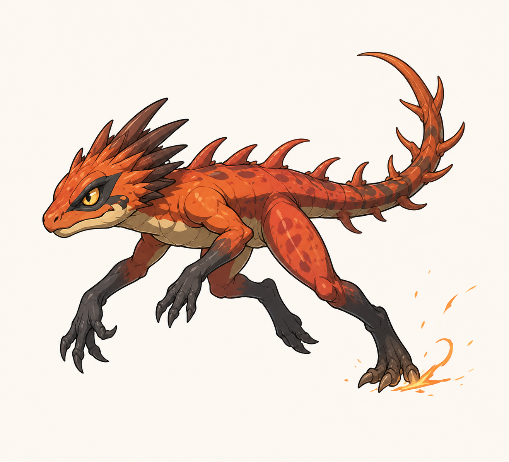

# Velocinder

> Concept record created September 3, 2026. Velocinder is the approved and production-integrated pure Fire-type second evolution of Fueguana; its journal artwork and both final branches remain open.

## Concept Summary

- **Name:** Velocinder
- **Name concept:** _Velocity_ + _cinder_, with an intentional sound association with _velociraptor_ that reinforces its swift, hind-leg-driven reptilian silhouette
- **Final ID:** `velocinder`
- **Typing:** Fire
- **Evolutionary stage:** Second stage of the Fueguana family
- **Creature basis:** A fast spiny-tailed iguana with an increasingly bipedal running gait
- **External inspiration:** Cannon-fuse races, friction sparks, rapid acceleration, and the adolescent transition from four-legged scrambling to hind-leg sprinting
- **Evolution family:** Fueguana -> Velocinder -> either a noble final branch or a cursed final branch; both final names and approved designs remain open
- **Core concept:** Fueguana's mischief and gunpowder appetite mature into explosive speed as Velocinder begins balancing on its enlarged hind legs and using its long thorned tail to steer through sharp turns.
- **Signature silhouette:** A long, low orange runner with a wedge-shaped masked head, oversized hindquarters, airborne forelimbs, and an extremely long tail whose backward-swept thorns grow larger toward its hooked tip.

## Character and Story Hook

Velocinder should feel thrilling, competitive, and still slightly mischievous. It has discovered that it can outrun the trouble Fueguana once escaped by hiding, but its confidence in its speed makes it prone to accepting races before noticing where the course leads.

Its central contradiction is that improved balance gives it greater control while the excitement of running makes it less attentive. It eagerly races lit cannon fuses across pirate decks, treating the spreading flame as a moving rival rather than recognizing the danger around it.

This behavior is species-level. After consuming so much gunpowder, Velocinder's entire body builds elemental heat and can throw sparks from its scales when it accelerates. Its feet and thorned tail are the most visible discharge points, especially while sprinting or cornering. Velocinder instinctively chases fast-moving sparks, darts along rigging and deck lanes, and uses its hind legs and tail as a coordinated steering system. A patient bond can turn that confidence into disciplined agility; exploitation or cursed influence could twist the same drive into frantic, self-destructive speed.

## Inspiration

Black spiny-tailed iguanas (_Ctenosaura similis_) are fast terrestrial lizards with rings of curved tail spines. They sprint to escape danger, lash with their tails when cornered, and shift from bright juvenile coloration toward darker adult scales. These traits support Velocinder's speed, adolescent orange-and-charcoal palette, and increasingly thorny tail.

- [ZooAmerica: Black spiny-tailed iguana](https://www.zooamerica.com/animals/spiny-tailed-iguana/)

Green iguanas can use their tails as defensive whips and can detach part of the tail when captured. The existing Fueguana design and lore fictionalize those real defenses as an explosive detachable tail.

- [Animal Diversity Web: Green iguana](https://animaldiversity.org/accounts/Iguana_iguana/)
- [Kyoto City Zoo: Green iguana](https://zoo.city.kyoto.lg.jp/zoo/animals/i_iguana)

Black powder combines charcoal, sulfur, and an oxidizing nitrate. It ignites readily and burns rapidly, while the expanding hot gases create explosive force. This provides the external foundation for the Fueguana family's gunpowder appetite, cannon-fuse imagery, and acceleration metaphor.

- [National Park Service: Gunpowder](https://www.nps.gov/casa/learn/historyculture/gunpowder.htm)
- [NOAA CAMEO Chemicals: Black powder](https://cameochemicals.noaa.gov/chemical/14053)

The following elements are fictional Cosmoids-world extrapolations rather than claims about real iguanas or black powder:

- evolving a facultative bipedal sprint as an elemental growth stage;
- deliberately racing lit cannon fuses;
- storing gunpowder-fed elemental heat throughout the body and producing visible sparks while cornering at speed;
- a thorned tail functioning as a high-speed steering counterweight;
- Fire typing and the noble-versus-cursed final evolution split.

## Fusion Logic

`fast spiny-tailed iguana + cannon-fuse race + adolescent mastery of momentum -> a competitive Fire runner whose growing hind legs and thorned steering tail turn Fueguana's impulsive mischief into exhilarating speed`

The fuse-racing inspiration changes Velocinder's proportions, gait, characteristic behavior, personality, combat premise, evolution arc, journal entry, and final name. It is not merely a fast orange iguana: it is a reckless young competitor learning whether speed will become disciplined freedom or compulsive escape.

## Signature Vignette

A cannon fuse begins to hiss across a ship's deck. Velocinder's eye narrows with delight, its forelimbs lift, and its enlarged hind legs launch it alongside the moving spark. It leans into a tight turn as its long thorned tail sweeps outward to counterbalance the body.

The approved standalone image captures this running action without depicting the fuse or ship. Future animation and journal art may place the same behavior in a natural pirate-era setting without redesigning the creature.

## Journal Entry

> Once it learns to balance on its hind legs, it becomes fast enough to race a lit cannon fuse. Its thorny tail sprays sparks around every sharp turn.

## Visual Direction

- Long, lean adolescent iguana anatomy in a low forward-running line of action.
- Narrow horizontal trunk rather than a vertical or humanoid torso.
- Hindquarters and thighs substantially larger and stronger than the forequarters.
- Forelimbs extended but airborne in the approved running pose, showing a transitional gait that can still return to all fours.
- Long lower hind legs with one rear foot planted and the other lifted mid-stride.
- Extremely long counterbalancing tail that curves upward and backward.
- Organic hooked thorns along the outer tail, increasing in size and visual emphasis toward the tip.
- Orange-red scale masses with darker red mottling across the back, flanks, thighs, and tail.
- Charcoal-brown forearms, lower hind legs, claws, upper crest tips, and tail bands.
- Warm cream lower jaw, throat, belly, and tail underside.
- Narrow wedge-shaped reptilian head with a swept-back crown and neck crest.
- One bold charcoal eye-mask marking around each golden-yellow eye.
- Tall triangular spines create a backward-flowing rhythm from the head along the spine and tail.
- Fire effects remain restrained. Gunpowder-fed heat builds throughout the body, while the feet and thorned tail act as the clearest outlets for sparks during acceleration and sharp turns.
- No clothing, bandana, weapon, armor, carried gunpowder, or other removable equipment.
- Approximately 1.1 metres from snout to tail tip when fully extended.

The concept image is the visual authority. Future production art may change the viewing angle and running phase to reveal anatomy, but it must preserve the identity checklist below and remain recognizably the same creature.

## Approved Identity Checklist

- **Silhouette:** Long horizontal runner with a low wedge head, compact forequarters, huge hind-leg mass, airborne forelimbs, and a tail arc that extends farther than the torso.
- **Body plan and proportions:** Adolescent iguana with one head, a long narrow trunk, exactly four limbs, enlarged muscular thighs, elongated lower hind legs, and one exceptionally long tail.
- **Head and face:** Narrow tapered muzzle; cream lower jaw; orange brow and snout; swept layered cranial spines; confident closed mouth.
- **Eye design:** Golden-yellow eye with a vertical dark pupil, pale highlight, and a heavy charcoal mask extending backward from the orbit.
- **Appendages:** Exactly two forelimbs, two hind legs, and one tail; no wings, fins, horns, or extra arms.
- **Signature anatomy:** Oversized sprinting hind legs and a long steering tail ringed with organic hooked thorns that become largest near the curved tip.
- **Palette:** Saturated orange and vermilion; dark rust mottling; charcoal-brown limbs, crest tips, claws, mask, and tail bands; warm cream underside; restrained golden sparks.
- **Markings:** Irregular darker dorsal and flank patches, segmented dark tail bands, charcoal limb gradients, and one clean mask around each eye.
- **Materials:** Smooth stylized reptile scales, larger plate-like cream belly scales, hard keratin spines and claws, and restrained friction sparks.
- **Shape rhythm:** Nearly every major point sweeps backward: crown crest, dorsal spines, limb gesture, tail curve, and hooked tail thorns. The massive hind-leg ovals contrast with the narrow head and extremely long tail.
- **Characteristic posture:** A stretched running bound with the torso nearly horizontal, forefeet clear of the ground, one hind foot planted, and the tail lifted as a counterweight.
- **Expression:** Focused, competitive, and pleased with its own speed rather than angry, feral, noble, or cursed.

## Evolutionary and Story Premise

Fueguana is a small four-legged shipboard troublemaker that eats gunpowder, starts fires, and escapes by sacrificing its explosive tail. Velocinder is the adolescent stage where that impulsive energy becomes locomotion: it grows powerful hind legs, begins lifting its forelimbs during a sprint, and learns to steer with a longer, more heavily thorned tail.

The middle evolution remains morally and visually neutral. On a future noble route, Velocinder's love of speed could mature into precision, restraint, and the freedom to protect or outmaneuver others. On a future cursed route, pain or exploitation could turn the same competitive drive into frantic motion, loss of control, or an inability to stop. Neither final form should be treated as approved until its own design workflow is complete.

## Design Tests to Preserve

- **Ten-word read:** A thorn-tailed fire iguana learning to sprint on two legs.
- **Five-second read:** Masked orange runner launches after a fuse, tail steering wide.
- **Silhouette read:** Narrow wedge head, huge hind legs, airborne forelimbs, enormous thorned tail.
- **Character contradiction:** Better physical control makes it more willing to chase reckless thrills.
- **One surprise:** It treats a burning cannon fuse as a racing opponent.

## Creation Record

- **Original direction selected:** Fueguana second-evolution ensemble, option 4
- **Visual direction:** Faster, more nimble adolescent beginning to stand and run on its rear legs
- **Visual approval date:** September 3, 2026
- **Final-name approval date:** September 3, 2026
- **Final ID:** `velocinder`
- **Concept-art file:** `docs/cosmoids/images/velocinder-concept.png`
- **Image status:** Approved standalone visual identity reference supplied by the user
- **Journal-entry status:** Approved working entry recorded above
- **Implementation status:** Production-integrated with a tight portrait icon, left/up/down battle art, creation record, registry and tower-defense configs, Fueguana's level-16 evolution logic, reused attacks, tuned stage-two stats, and a capturable Level 5 encounter

## Open Decisions

- Approve the noble third evolution's final design, name, typing, and relationship to Velocinder's speed.
- Develop and approve the cursed third evolution without treating its pain as an uncomplicated power upgrade.
- Define the branch methods, including how cursed relic exposure affects the final evolution.
- Develop Velocinder's journal artwork through the dedicated journal-art workflow after its natural habitat and observed behavior are finalized.
