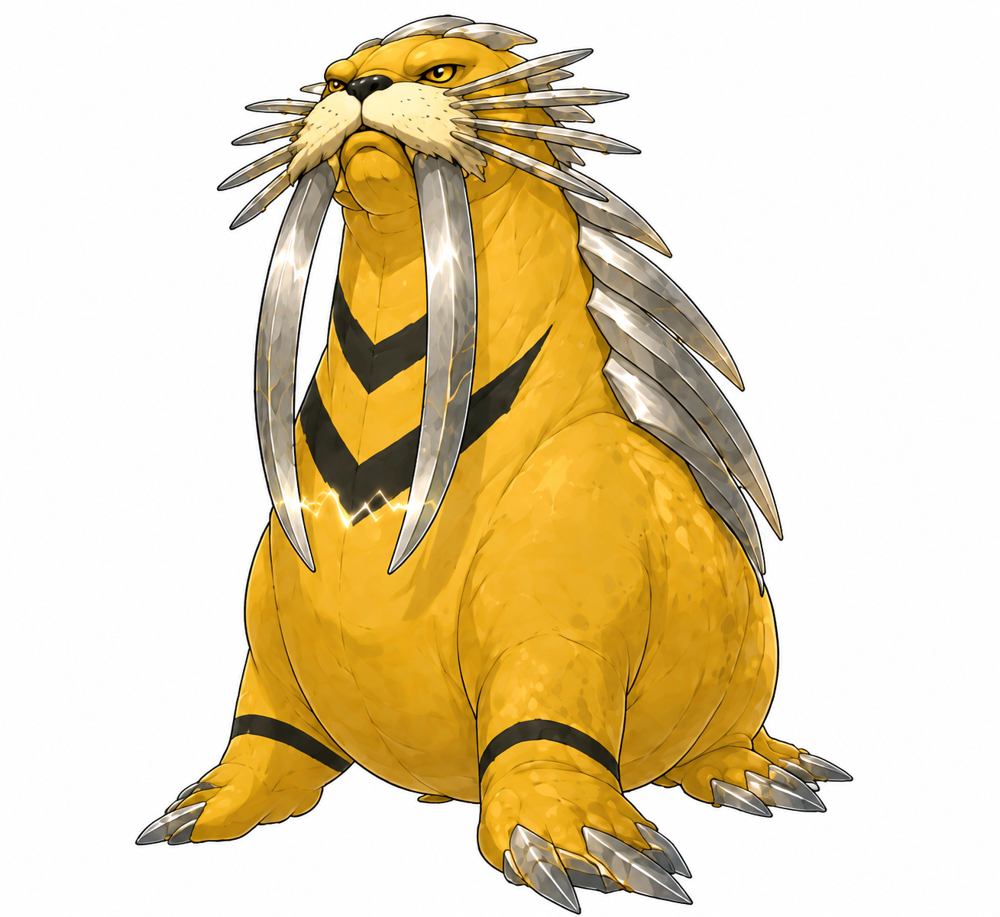

# Voltusk

> Updated September 6, 2026. Name, visual design, core lore, and all four normal-form assets are approved. Transparent assets, species registration, directional visuals, and the creation record are complete. The Level 6 encounter remains planned.

## Concept Summary

- **Name:** Voltusk
- **ID:** `voltusk`
- **Name concept:** Volt + tusk, directly connecting electricity with its defining anatomy.
- **Typing:** Steel/Electric
- **Evolutionary stage:** Final form; earlier family stages remain unspecified.
- **Creature basis:** Walrus, with Pacific walrus biology informing its sensitive whiskers and tusk displays.
- **External inspiration:** Lightning collection, electrical energy storage, and the relationship between visible strength and social status.
- **Story placement:** The Ironbell Navy officer's boss partner in [Level 6](../levels/level-6.md).
- **Core concept:** A proud storm-seeking walrus whose metallic whiskers locate impending lightning strikes and whose steel tusks store the resulting electricity.
- **Signature silhouette:** Tall, upright, heavy walrus with enormous curved steel tusks, a broad whiskered muzzle, and swept silver back plates.

## Approved Description

> Its metallic whiskers tremble when a storm approaches, guiding it to the place where lightning will strike. The larger its steel tusks, the more electricity it can store—and the more confidently it challenges rivals.

Keep the species description focused on these two connected ideas. Bell- or gong-like calls are reserved as an optional encounter-design inspiration, not another central lore premise.

## Character and Story Hook

Voltusk is proud, imposing, and normally controlled in its use of force. Its tusks visibly advertise how much electrical power it can hold; larger tusks permit stronger discharges and give it greater confidence when confronting rivals. Its restrained electrical warnings express strength without requiring immediate violence.

Its contradiction is formidable power paired with deliberate restraint. The Level 6 officer mistakes that restraint for weakness and forces it into a Cursed Aura state through unidentified, unseen means. The resulting uncontrolled release of power hurts Voltusk, preserving the distinction between the officer's cruelty and the suffering of his partner.

The storm-seeking behavior and tusk storage are species traits. The officer relationship and forced curse belong to this individual encounter, rather than defining every Voltusk as an obedient Navy creature.

## Inspiration and Fictional Translation

Real walruses have sensitive whiskers that help them find food on the seafloor. Their tusks are elongated upper canine teeth, and males display them in confrontations where relative tusk size can influence whether a rival withdraws. These observations inform Voltusk's sensory moustache, proud bearing, and tusk-based status. [Alaska Department of Fish and Game: Pacific walrus profile](https://www.adfg.alaska.gov/index.cfm?adfg=walrus.printerfriendly)

**Creative bridge:** Sensitive walrus whiskers + tusk displays + lightning collection and energy storage -> a creature that finds lightning strikes, stores their energy in its steel tusks, and displays those tusks as a credible measure of strength.

Predicting the exact strike location, safely receiving lightning, growing steel anatomy, and storing electricity in tusks are fictional Cosmoid abilities. They are not claims about real walruses or ordinary steel. The design does not require a literal machine or a technical explanation of its internal storage mechanism.

Real walruses also produce bell- and gong-like calls. This is a separate possible source for Level 6 audio and mechanics; no specific call effect has been chosen. [Alaska Department of Fish and Game: Sounds Wild — Walrus](https://www.adfg.alaska.gov/index.cfm?adfg=soundswild.episode&id=walrus)

## Signature Behavior and Vignette

As a storm approaches, Voltusk's metallic whiskers tremble. It adjusts its position until it reaches the impending strike location, plants its flippers, and raises its head. Lightning strikes its steel growths, and the energy channels into its tusks.

The short visual vignette is the final brace and raised head, followed by a contained arc between the charged tusks. This behavior may guide future art or animation; it does not establish a required storm or lightning-recharge mechanic in Level 6.

## Visual Direction and Identity Lock

The approved standalone image above is the visual identity authority. Preserve it when generating the icon, directional sprites, or later art:

- Tall, upright pear-shaped body, heavy belly, raised chest, and dignified three-quarter posture.
- Golden-yellow skin with restrained ochre shading and subtle tonal patches. Do not revert the body to blue or teal.
- Exactly two bold black downward-pointing chest chevrons and a black band near the end of each front flipper. No additional flank stripes, black face mask, dark shoulder mantle, or navy markings.
- Small stern amber eyes, a blunt black nose, a broad cream muzzle, and a cream moustache.
- Lateral fans of thick, flattened silver metallic whiskers; preserve their placement and characteristic shape rhythm from the image.
- Two enormous flattened silver steel tusks, smoothly curved down along the chest and inward toward their tips. Preserve their length, spacing, and curvature.
- Silver brow growths and overlapping swept silver plates down the back, prominently visible on the image's screen-right side.
- Two broad weight-bearing front flippers with pointed steel tips and a smaller rear flipper pair. Hidden anatomy in other views must follow the visible walrus body plan conservatively.
- Natural silver steel features remain distinct from yellow living skin; these are anatomical growths, not a removable armor suit.
- The small pale yellow-white electrical arc between the lower tusks belongs to the approved illustration. Additional effects must not obscure the face or silhouette.
- No net, rope, Navy uniform, insignia, tools, or other equipment is part of Voltusk's visual identity.

Preserve the reference's proportions, facial structure, appendages, palette, markings, materials, and silhouette through changes of viewing angle. Use the project's smooth painted 2D battle-art finish for production assets. The white concept background is not a shipped transparent sprite.

## Level 6 Gameplay and Story Intent

The officer throws a steel net over Tigrevel as Navy equipment, then sends Voltusk and Electric minions to drag Tigrevel back into captivity. Voltusk does not create the net. The minions' behaviors and any electrical interaction with the hauling effort remain undecided.

At 30% Voltusk health, the battle pauses for a short five-panel intermission. The officer forces Voltusk into a Cursed Aura state, but the means by which he does so is neither named nor shown. A painful dark-purple Cursed Aura appears, and Voltusk's electric-orb attack begins marking up to three distinct valid targets at once instead of one. This is not a permanent Cursed evolution. Voltusk retains its remaining health after the intermission.

Defeating the boss frees Tigrevel. Strake is stunned by the loss, Kip urges everyone to run before he recovers, and the children immediately escape to Ironbell harbor.

Bell or gong calls may contribute to this encounter, but their timing, effects, and relationship to minions are open. Follow the [Level 6 record](../levels/level-6.md) for the broader objective, recruitment ending, and unsettled battle details.

## Approved Stat Direction

Approved October 1, 2026: Voltusk is a final form with substantial HP, strong
physical defense, and powerful special attacks. Its weight and steel tusks also
support credible physical attacks. Special defense is solid but lower than
physical defense; very low speed is its defining limitation. These tendencies
preserve its heavy, armored identity when using shared or off-type moves.

[Walrein](https://pokemondb.net/pokedex/walrein) supplied the body and bulk
comparison, while [Magnezone](https://pokemondb.net/pokedex/magnezone) supplied the
Steel/Electric special-attacker comparison. The approved spread favors living
body mass over Magnezone's greater special power and speed.

The authored stats live only in
[`creatures.ts`](../../apps/web/src/constants/creatures.ts). This approval
replaces the initial integration defaults; Level 6 encounter multipliers still
require separate balance evaluation.

## Creation Record

- **Final name selected:** Voltusk
- **Name and concept documentation date:** September 6, 2026
- **Concept-art file:** `docs/cosmoids/images/voltusk-concept.png`
- **Approved source image:** `exec-c19f0ea7-3cbf-44fc-b35c-8b7ca3428412.png`
- **Visual selection:** Regal walrus direction, golden-yellow recolor, then marking variation 3 with black chest chevrons and flipper bands.
- **Image status:** Approved standalone concept, copied unchanged from the generated source.
- **Production status:** All four previews approved before background removal, per the user's instruction. Transparent head icon and left/down/up sprites are exported and registered; see [the asset review and final exports](reviews/voltusk/README.md) and [creation provenance](../art/CREATURE_PROVENANCE.md). Right-facing visuals mirror the left sprite.
- **Initial gameplay defaults:** Integrated as a slow, bulky special attacker with reused movement and attacks. Its placeholder stats were replaced by the approved October 1, 2026 stat direction above. Current gameplay values are owned by the species registry.
- **Placement status:** Reserved as the Level 6 boss in the creature design document. The runtime still has a locked Level 6 placeholder, so no waves or capture policy have been added. The creature is registered independently of the future encounter.

## Open Decisions

- Decide whether Voltusk has earlier family stages; its final-form status is approved, but no earlier forms are designed.
- Define broader habitat, distribution, physical size, diet, and ecology beyond its approved storm-seeking behavior.
- Tune the initial display scale and gameplay defaults during Level 6 encounter balancing.
- Decide boss and minion mechanics, including whether bell/gong calls or lightning collection have gameplay effects.
- Tune the existing Cursed Aura treatment and three-target electric-orb phase while preserving Voltusk's identity.
- Decide Voltusk's capture availability and longer-term fate after the officer's defeat.
- Create journal artwork through the dedicated journal workflow when requested.
