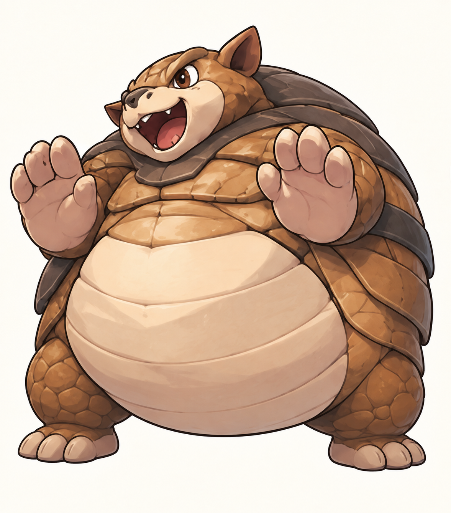

# Yokodillo

> Final name and standalone visual identity approved September 18, 2026. Production icon, directional battle assets, Fighting element support, species registration, gameplay defaults, and manifest were completed the same day. Journal artwork was completed September 22, 2026; Level 7 runtime integration and custom techniques remain pending.

## Concept Summary

- **Name:** Yokodillo
- **Repository ID:** `yokodillo`
- **Name concept:** _Yokozuna_ + _armadillo_, joining sumo's highest rank to the creature's animal basis.
- **Typing:** Fighting
- **Creature basis:** Southern three-banded armadillo
- **External inspiration:** Sumo wrestling, friendly island sparring, and a restrained wooden-cask influence in the round armored silhouette and warm brown palette.
- **Character core:** A jovial, grounded brawler that genuinely enjoys being pushed and treats a contest of strength as an invitation to play.
- **Core concept:** A Fighting-type armadillo Cosmoid that plants itself in a sumo stance, absorbs an opponent's shove through its broad armored body, then answers by curling into a rolling charge.
- **Signature silhouette:** A huge round belly inside a layered armadillo shell, two raised open palms, and two stout legs planted in an unmistakably wide, stable base.

## Character and Story Hook

Yokodillo is competitive without being hostile. It squares up with an eager grin, raises both palms, and waits for another creature to test its footing. Being moved is not an insult—it is the most exciting part of the game.

Its comedy comes from the contrast between control and momentum. Yokodillo looks immovable while braced, but once it curls up and starts rolling, it may travel much farther than it meant to. That makes it a natural fit for a relaxed island visit where the crew and local Cosmoids are stretching, playing, and sparring rather than fighting for survival.

## Inspiration and Fictional Translation

### Verified natural and cultural anchors

- The [Smithsonian's southern three-banded armadillo profile](https://nationalzoo.si.edu/animals/la-plata-three-banded-armadillo) describes the animal's protective bony scutes and its ability to curl into a complete ball with its vulnerable parts tucked inside.
- The [Japan Sumo Association's introduction to sumo](https://www.sumo.or.jp/pdf/en/sumo_introduction.pdf) identifies _yokozuna_ as the highest rank in professional sumo. Sumo's pushing contest, low preparation stance, and deliberate pre-bout composure inform Yokodillo's posture and personality.

### Creative bridge

The armadillo's rolling defense becomes an enthusiastic counterattack, while sumo supplies the planted feet, open pushing hands, round center of mass, and joyful contest of balance. The subtle keg-like read helps the creature belong on a pirate-adventure island without turning it into a literal barrel or costume character.

### Fictional elements

Yokodillo's wood-toned shell, playful challenge behavior, belly-first shove, and rolling follow-up are fictional Cosmoid traits rather than claims about real armadillos or sumo wrestlers.

## Signature Behavior and Vignette

Yokodillo plants both feet, lifts its palms, and invites another Cosmoid to push with all its strength. When it is finally displaced, it laughs, curls into an armored ball, and barrels back across the clearing—often overshooting its partner and rolling into the brush beyond.

This vignette defines the creature's temperament and visual action, but it does not yet lock a named attack or gameplay mechanic.

## Visual Direction and Identity Lock

The approved standalone concept image is the authority for Yokodillo's future assets.

- **Body plan:** Exactly two arms and two legs around a massive round, pear-to-oval torso. The broad segmented belly is the visual center.
- **Stance:** Both feet must be visibly planted in a low, wide, balanced sumo base. Avoid the earlier off-balance raised-foot read.
- **Head and face:** A small triangular-eared head sits close to the torso, with a tan facial mask, large lively brown eyes, and a cheerful open grin with small teeth and a pink tongue.
- **Hands and arms:** Two broad open hands are raised for pushing. Each has a rounded four-digit appearance, pale palms, and scaled armadillo forearms.
- **Feet:** Two stout feet with three pale claws or toes visible on each foot where the angle permits.
- **Armor:** Overlapping medium-brown armadillo plates wrap the shoulders, flanks, and back. Dark charcoal-brown carapace plates create a heavy upper and rear rim.
- **Belly construction:** Pale cream belly plates form flexible horizontal bands. Preserve the clean approved segmentation; do not introduce a stray vertical crease line.
- **Palette:** Oak and caramel brown, deep charcoal brown, pale cream on the belly, muzzle, palms, and toes, and warm pink inside the mouth.
- **Shape language:** Nested arcs, broad circles, layered plates, open palms, and a wide grounded triangle between the feet.
- **Prohibited additions:** No metal barrel hoops, literal barrel body, clothing, mawashi, pirate costume, weapons, props, or decorative symbols.
- **Rendering:** Smooth painted 2D game illustration with clean dark-charcoal outlines, controlled soft cel shading, and no pixel-art treatment.

## Level 7 Story and Encounter Intent

Yokodillo is proposed for Level 7, a relaxing no-objective island stop that the player cannot lose. The crew has gone ashore to stretch their legs, and Yokodillo turns that same impulse into friendly pushing games and rolling contests. It can share the island's creature roster with Dormatee, providing lively physical comedy against Dormatee's tranquil Psychic presence.

The island's final name, Yokodillo's exact location, spawn rate, capture flow, and any scripted interaction remain open.

## Evolution and Scale Intent

Yokodillo was conceived to read clearly as a self-contained single-stage creature, but its evolutionary status has not been locked. An approximate height near 0.8 metres was discussed as an early scale cue and remains provisional.

## Creation Record

- **Creation date:** September 18, 2026
- **Final name selected:** September 18, 2026
- **Concept development:** Selected from the fifth Fighting-type direction, refined through ten torso variations, then finalized from variation 3 with the far foot corrected into a firm planted stance.
- **Approved concept image:** [`docs/cosmoids/images/yokodillo-concept.png`](./images/yokodillo-concept.png)
- **Image status:** Preserved unchanged from the user-approved standalone render.
- **Production assets:** `yokodillo_icon.png`, `yokodillo_left.png`, `yokodillo_up.png`, and `yokodillo_down.png`
- **Directional identity revision:** On September 19, 2026, all three battle sprites were rebuilt to restore the approved concept's short muzzle, compact ears, oversized palms, broad armor plates, dark shoulder collar, three-band belly, grounded stance, and compact tail.
- **Gameplay status:** Registered as a pure Fighting-type bulky physical creature with temporary existing attacks (`TACKLE` and `QUICK_ATTACK`) until its custom sumo techniques are selected.
- **Story status:** Reserved for Level 7 in the creature manifest; runtime placement awaits implementation of the level.
- **Journal observation:** Yokodillo settles its great belly close to the ground and uses its broad hands with unexpected delicacy, lifting loose bark to inspect the insects sheltering beneath it.
- **Journal artwork:** [`art-source/creatures/journal/yokodillo_journal.png`](../../art-source/creatures/journal/yokodillo_journal.png), published at `/UI/Journal/yokodillo_journal.webp`.
- **Journal artwork approval:** September 22, 2026

## Open Decisions

- Exact Level 7 placement, encounter presentation, rarity, and capture behavior
- Custom attacks, special abilities, and final balance tuning
- Final island name and any local environmental storytelling
- Broader habitat, diet, ecology, and any future revision of the journal entry
- Final scale and whether it remains single-stage or joins an evolution family
